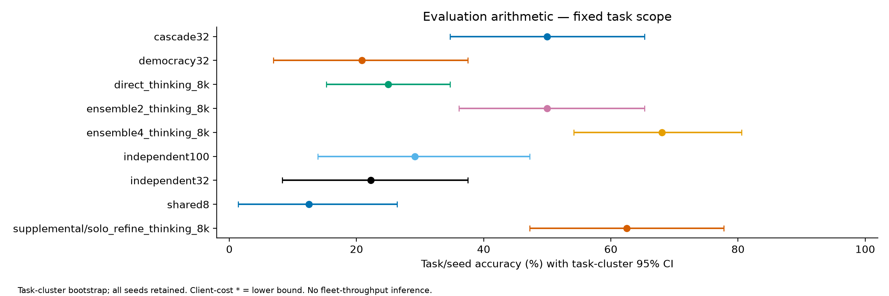
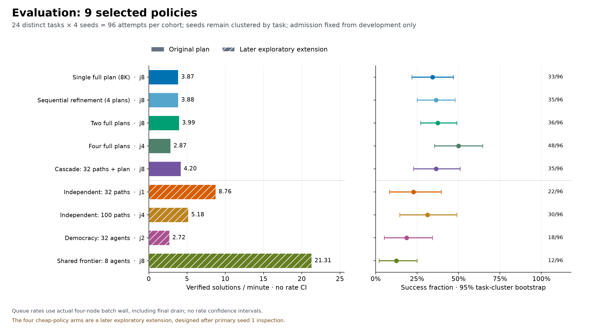
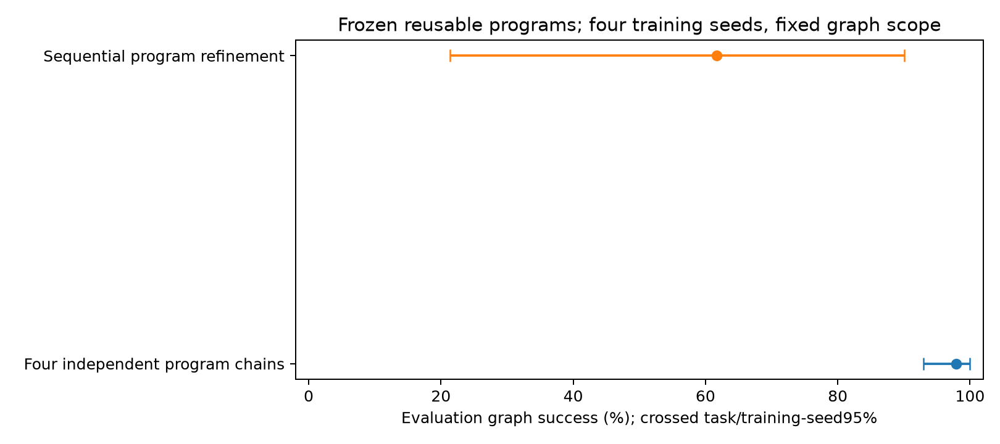
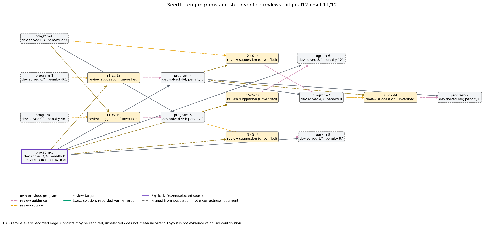

# What happened when we gave four DGX Sparks a swarm of small agents?

*Research article draft for the owner to edit and publish. All percentages below describe finite, mechanically checked task suites. This is an exploratory engineering study, not a claim of a generally optimal agent architecture.*

We wanted to find out whether a large population of small language-model agents could compensate for weak individual decisions. Could agents vote on each step, share partial progress, repair their own answers, evolve candidates, or turn rejected candidates into reviewers?

The useful result was more specific than “more agents are smarter.” Independent complete solutions and execution feedback helped. Voting at every step did not become the strongest method. The strongest graph results appeared when we switched to a different workflow: generating a reusable solver program and executing it on CPU. That changes both the candidate representation and the execution process.

The prototype, protocols, raw evidence and plots are in [Spark Swarm Lab](https://github.com/knapcio/spark-swarm-lab). Model-generated programs ran only inside constrained CPU Docker sandboxes.

## The hardware and model

We used four NVIDIA DGX Spark systems, each serving an independent replica of NVIDIA Nemotron 3.5 Lightning 30B-A3B NVFP4. The target weights occupy 21.56 GB per node, plus a 1.35 GB DSpark draft. The fixed study runtime was ARM64 vLLM 0.32.0 with three-token speculative decoding, a 16K context and 25 serving slots per replica.

That configuration admitted 100 simultaneous model requests across four machines. A logical agent is a prompt context and trajectory; it is not a separate model copy or a permanent GPU slot. The experiments used populations of different sizes and measured their actual requests, tokens and elapsed time.

A short serving qualification produced 69,158 completion tokens in 39.008 seconds, including warmups: about 1,773 output tokens/s across the fleet. That number measures this serving workload. It does not tell us how many problems the swarm solves.

Exact model, image, source and dataset revisions are recorded in the repository. We held the Nemotron checkpoint fixed across the valid study cohorts. Earlier instrumentation and runtime failures are retained as excluded diagnostics; they are not pooled into the results below.

## Whole solutions beat stepwise democracy on our arithmetic suite

The arithmetic suite contains 24 distinct tasks, each repeated with three sampling seeds. A move consumes two numbers and creates an arithmetic result; an independent exact-rational verifier checks the trajectory. Reaching the target is sufficient: consuming every starting number is not required.

| Method | Verified successes | Rate |
|---|---:|---:|
| Nemotron, one reasoning call | 18/72 | 25.0% |
| Nemotron, up to four sequential full plans with own feedback | 45/72 | 62.5% |
| Nemotron, up to four independent full reasoning plans | 49/72 | 68.1% |
| Nemotron, 32-agent stepwise democracy, thinking off | 15/72 | 20.8% |
| Native DeepSeek reference, one reasoning call | 72/72 | 100.0% |

The four-plan ensemble accepts any one full plan that passes the exact verifier; it is independent sampling with mechanical selection, rather than agreement on a final plan. It improved substantially over one Nemotron call. Its advantage over the stronger sequential control was only 5.56 percentage points, with a task-cluster 95% bootstrap interval from −5.56 to +16.67 points. That comparison does not establish a clear winner. The ensemble also consumed about 1.66 times as many server completion tokens as the sequential control.

The democracy configuration used a different thinking and output-budget recipe, so the table is not a clean causal test of voting alone. Its result does show that a large voting population was insufficient to rescue that recipe.

Repeated seeds are not new independent tasks. The uncertainty estimates resample tasks, retaining their repetitions. [Full comparison and cost accounting](results/solo-control-v2/complete-comparison/solo-comparison/REPORT.md).

## Accuracy and useful throughput selected different methods

We then ran separate loaded queues and selected admission levels on development tasks within a bounded grid of 1, 2, 4 or 8 cases per node. Each evaluation method received 96 attempts: 24 tasks and four repetition labels.

| Loaded-queue method | Successes / 96 | Successful attempts/min |
|---|---:|---:|
| One reasoning plan | 33 | 3.87 |
| Sequential reasoning refinement | 35 | 3.88 |
| Two independent reasoning plans | 36 | 3.99 |
| Four independent reasoning plans | 48 | 2.87 |
| Cheap 32-path search, then reasoning fallback | 35 | 4.20 |
| 32 independent cheap paths | 22 | 8.76 |
| 100 independent cheap paths | 30 | 5.18 |
| 32-agent stepwise democracy | 18 | 2.72 |
| Shared frontier, 8 contexts | 12 | 21.31 |

The shared-frontier policy moved quickly through this finite queue while solving relatively few attempts. The four-plan policy solved half the attempts but spent much longer on them. There was no universal efficiency winner: the useful policy depends on the required success probability and available compute.

These are observed finite-batch rates, with server drain included. The bounded admission sweep does not prove the globally best solo saturation point. Cheap-policy extensions were exploratory and are labelled separately in the protocol.

[Queue selection, latency and actual server token costs](results/throughput-timeoutguard-20261115/REPORT.md).

## Review and evolution did not rescue direct graph assignments

We added planted, satisfiable graph-coloring problems and exact conflict checks. Variants included resampling, sequential repair, parallel repair, genetic-style mutation/crossover, elite review, ordinary democracy and quality-weighted democracy. Votes aligned color labels before combining assignments; otherwise equivalent color permutations would create meaningless disagreement.

The original direct-assignment evaluation solved **0/252 core cases and 0/288 extended cases**. Many responses violated the required assignment length or color domain. Independent replay checked the retained assignment proofs, so this was not a hidden scoring success.

A later reasoning-enabled configuration also solved **0/96**. Every one of its 1,464 assignment calls used the entire 4,096-token cap in the separate reasoning field and returned no answer content. Its 72 reviewer calls completed normally. This is an observed output-budget failure for that configuration; it does not establish that the model cannot color graphs under any prompt or budget.

Classical CPU controls confirmed that the tasks were solvable: min-conflicts solved 30/36 original evaluation cases, and the genetic control solved 18/36. Their budgets and hardware differ from language-model calls, so those counts are context rather than a matched compute comparison.

## Asking for a reusable solver changed the outcome

Instead of emitting one graph assignment, Nemotron wrote a Python function `solve(n, k, edges)`. Training feedback came from only four development graphs. Each selected program was frozen before evaluation; evaluation failures could not trigger another model call or a different selection.

We compared two 16-call training workflows: one sequential refinement chain, and four independent chains of four calls. There were four paired training seeds per method.

| Program-training method | Original 12 graphs × 4 programs | Additional 96 graphs × 4 programs |
|---|---:|---:|
| Sequential refinement | 29/48 | 237/384 (61.72%) |
| Four independent chains | 47/48 | 376/384 (97.92%) |
| Elite review using bottom-ranked contexts | 47/48 | 376/384 (97.92%) |

For the first two table rows, the additional 96-graph confirmation was planned and its corpus frozen before the original program-training calls. Those two arms used 768 fresh CPU grades, zero additional model calls and no repairs. The reviewer row adds a separate 384-grade, late exploratory rerun on the already-known corpus. Three independently selected programs each solved all 96 additional graphs. That is a finite success, not a guarantee on arbitrary graphs.

The uncertainty is wider than the denominator 384 suggests: there are only four trained programs per method, evaluated on reused graphs from one generator. The independent-minus-sequential difference on the additional graphs was 36.20 points, with a crossed graph/training-seed bootstrap interval of +5.73 to +78.39 points. The result warrants replication with more independent training seeds and task generators.

[Original program study](results/program-search-v1-analysis/REPORT.md) · [additional confirmation](results/program-confirmation-v1-analysis/REPORT.md).

## Can rejected candidates become useful reviewers?

We tested that directly. An episode first produced four programs. In each of three rounds, two bottom-ranked program contexts reviewed two elites, then two new proposals used the critiques. Elites survived according to mechanically verified development fitness. The total remained 16 calls: ten program proposals and six reviews.

The reviewer variant matched the independent-chain totals on both evaluation sets. Its 96-graph rerun was a late exploratory test on a corpus whose earlier results were already known, so it is not a second untouched confirmation. The variant also changes elitism, prompts and the number of author calls; it does not isolate the causal effect of review.

These were stateless contexts from the same checkpoint. A bottom-ranked candidate is not evidence that its underlying model is a persistently worse individual. Review text was untrusted guidance, and exact execution feedback remained the selection authority.

The trace below shows real proposals and critique links from the lowest-labelled training seed, selected by that label rather than its score. Its initially generated program remained the winner, so this picture does not claim that a review caused an improvement.

[Reviewer costs, lineage and audit](results/program-review-v1.1-analysis/REPORT.md).

## What the stronger-model reference tells us

The saved native DeepSeek TP4 service completed all 126 original reference attempts: 72/72 arithmetic and 54/54 coding. Nemotron's single reasoning coding control already achieved 53/54, leaving little room for the swarm on these 18 relatively small programming tasks.

This DeepSeek is a specifically pinned custom abliterated DeepSeek-V4.1-Flash checkpoint, served by the saved pico/dsgb10 engine across all four Sparks. It is not an official hosted DeepSeek benchmark, and its four-GPU resources, reasoning effort and sampling recipe are not matched to one Nemotron replica. All reference outputs received independent verification. Client/provider usage is available; complete server-wide token cost is unknown, so we do not turn its batch time into a fleet throughput comparison.

[Completed DeepSeek comparison, cost scope and audit](results/reference-deepseek-v1-analysis/REPORT.md).

The planned Opus 5.5 reference could not run because the existing account had reached its weekly usage limit. It has no quality score in this study. The optional GLM Flash plus swarm hybrid was deferred; no hybrid results are claimed.

## What we would test next

The strongest next experiment is a larger, prospectively fixed comparison of reusable-program search, independent search and reviewer-assisted elitism. Match training budgets, vary the number of training seeds, add different generators, and test on tasks with enough headroom to avoid the coding suite's ceiling.

It would also be useful to compare confidence learned from verified past performance with confidence claimed by agents, and to measure whether reviewer contexts add value beyond spending the same calls on more independent proposals. Shared memory should carry explicit provenance and verification status; this study did not establish a benefit from an unrestricted shared memory store.

The practical lesson from this run is narrow but useful: execution feedback and the representation of the candidate mattered more than simply creating a large population. The small model could write a solver that generalized within this graph family even when asking it to output assignments directly failed. Cooperation remains a hypothesis to test against strong independent and sequential controls.

## Evidence and limitations

The repository preserves frozen plans, source revisions, request/event traces, captured outputs, exact verifier results, instrumentation-exclusion records, token accounting, uncertainty procedures and real lineages. Nemotron prompts and settings are reconstructed from frozen source and events; those studies did not capture wire-level requests. The later DeepSeek reference separately retains its actual transport request and response records. [Reproduction guide](REPRODUCING.md) explains what can be replayed from published evidence and what needs model endpoints or the original fleet.

The primary coding study originally used a same-interpreter grader later shown vulnerable to false passes. Independent outer-parent confirmation reconciled all 324 original case outcomes: 295 passes, 28 failures and one no-candidate failure. See [the grader audit](CORRECTNESS_AUDIT.md). The confirmation code verifier is a constrained CPU execution boundary with a trusted outer parent; it is not a mathematical proof of arbitrary Python behavior. Private expected values were not passed to generated child code in the confirmation grader. Original coding holdout scores were independently confirmed; later robustness probes remain separate. No stronger model advised the Nemotron runs at runtime. Operator and research audits used stronger assistants, and the DeepSeek reference was a later, separate run.

No universal optimal swarm, general 100% correctness, equal-compute model ranking, energy efficiency or novel algorithm is established by these experiments. Program search with execution feedback has substantial prior work, including the primary references recorded in [the experiment plan](EXPERIMENT_PLAN.md).
