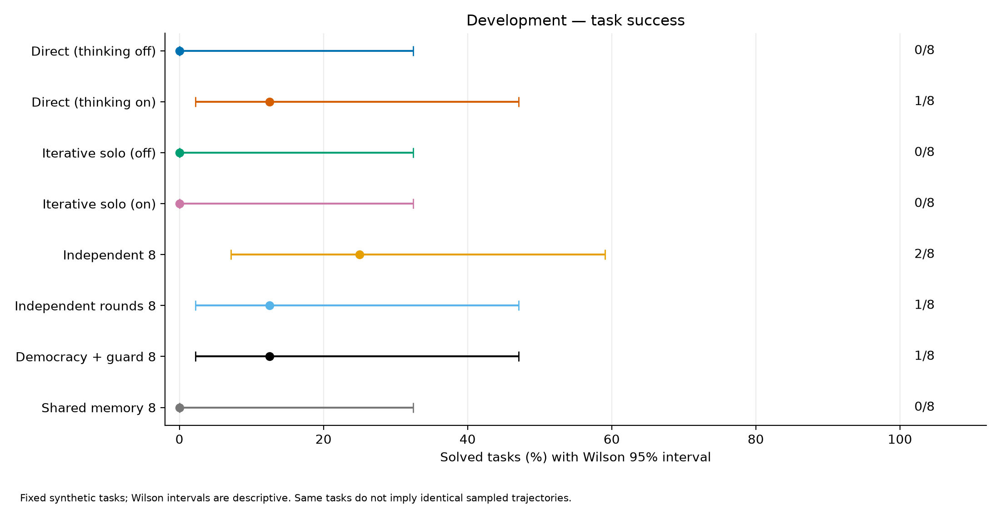
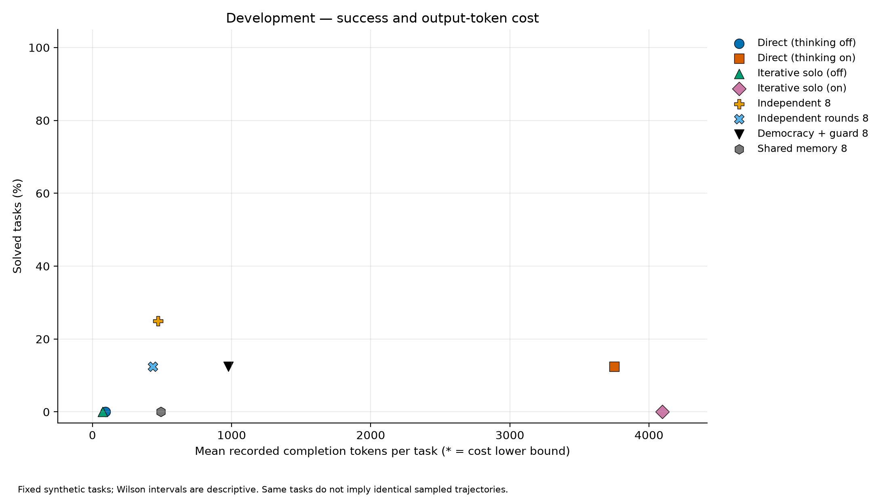
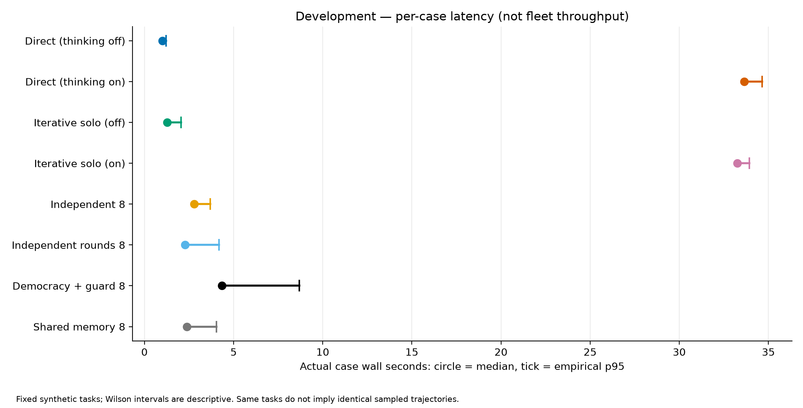
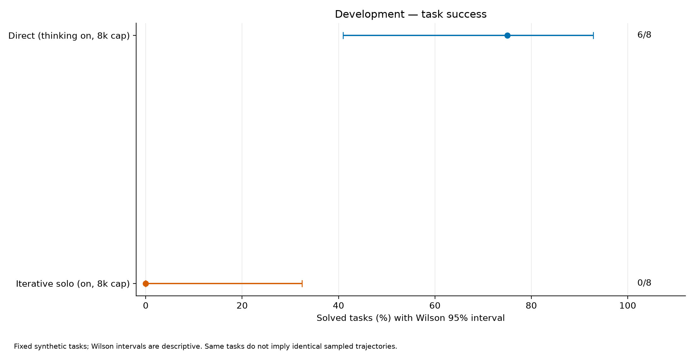
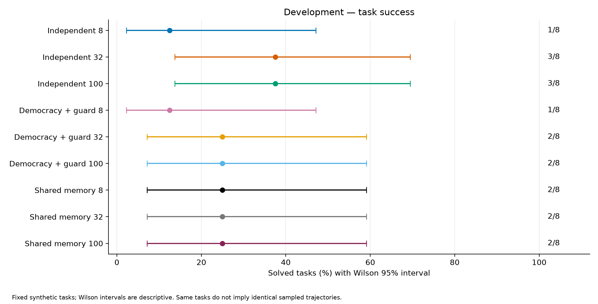
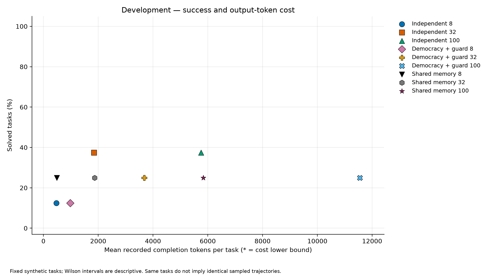

# Development calibration — 2026-11-15

This is public progress on [spark-swarm-lab](https://github.com/knapcio/spark-swarm-lab), not a final evaluation or an article conclusion. The first development cohort contains **8 synthetic tasks × 8 arms = 64 completed cases**, seed 1. The 24 evaluation tasks were not run in this cohort. The construction distribution is small and synthetic; task difficulty is not guaranteed to match real agent work.

## Recorded setup and limits

- Four fixed job slots, each owning one Spark/endpoint; one task’s rotated arms run sequentially on its assigned node. Groups have eight agents on that same node. This measures latency and task-solving calibration, **not saturated four-Spark throughput**.
- Official Nemotron 3.5 Lightning NVFP4 with DSpark3; configuration snapshot, model/draft/image revisions and source hashes are preserved in [metadata](results/development-20261115/base/metadata.json). Source commit: `24bf2e6996c617aaa77f92059f7ab2f3f8a9f007`; captured start/end source hashes match.
- Per case: 128-call ceiling, 32,768 completion token ceiling, five rounds, temperature 0.8; thinking OFF responses capped at 192 tokens, thinking ON at 4096. Actual input usage is recorded; there is **no input-token cap**.
- Every case has a 180-second controller deadline. This cohort recorded no deadlines, infrastructure failures, missing token usage or budget denials. Response-format errors and length finishes remain separate measurements.
- Whole mixed-arm queue wall time: **176.815253 seconds**. Per-arm case-time sums are not fleet wall time, and this mixed-arm wall cannot be used to infer per-arm fleet throughput.

## Observed development results

Wilson 95% intervals below describe these eight task outcomes per arm. All intervals overlap; this sample does **not** establish a winner. It is being used to diagnose settings before evaluation.

| Arm | Solved | Wilson 95% | Calls | Prompt tokens | Completion tokens | Median wall s | p95 wall s | Length finishes |
|---|---:|---:|---:|---:|---:|---:|---:|---:|
| Direct (thinking off) | 0/8 | 0.0–32.4% | 8 | 1,325 | 742 | 1.010 | 1.203 | 0 |
| Direct (thinking on) | 1/8 | 2.2–47.1% | 8 | 1,325 | 30,000 | 33.640 | 34.645 | 6 |
| Iterative solo (off) | 0/8 | 0.0–32.4% | 28 | 3,399 | 587 | 1.276 | 2.045 | 1 |
| Iterative solo (on) | 0/8 | 0.0–32.4% | 8 | 1,037 | 32,768 | 33.254 | 33.922 | 8 |
| Independent 8 | 2/8 | 7.1–59.1% | 242 | 29,419 | 3,780 | 2.780 | 3.686 | 1 |
| Independent rounds 8 | 1/8 | 2.2–47.1% | 224 | 27,346 | 3,476 | 2.285 | 4.184 | 1 |
| Democracy + guard 8 | 1/8 | 2.2–47.1% | 472 | 91,632 | 7,814 | 4.346 | 8.694 | 1 |
| Shared memory 8 | 0/8 | 0.0–32.4% | 256 | 31,061 | 3,940 | 2.379 | 4.046 | 1 |

**Observed cap issue:** direct thinking ON had 6 length finishes in 8 calls; iterative solo thinking ON had 8 in 8. The latter consumed 4096 completion tokens on every first move and produced no accepted progress. Those are measurements of the 4096-token configuration, not evidence that reasoning in general is worse. The separate 8192-token development follow-up is now complete and reported below; these original negative cases remain unchanged.

Independent 8 solved 2/8 here. Its interval overlaps the one-success and zero-success arms; additional development tuning or selecting a finalist does not turn this into held-out evidence. No article or final evaluation claim is made.

## Figures and data







- Standalone SVG: [accuracy](results/development-20261115/base/analysis/accuracy-wilson95.svg), [output-token cost](results/development-20261115/base/analysis/success-vs-completion-cost.svg), [latency](results/development-20261115/base/analysis/case-latency.svg).
- [64-case CSV](results/development-20261115/base/summary.csv), [64-case JSON](results/development-20261115/base/summary.json), [arm-level CSV](results/development-20261115/base/analysis/summary.csv), [paired task table](results/development-20261115/base/analysis/paired-results.csv), [analysis JSON](results/development-20261115/base/analysis/analysis.json).
- [Trace/log directory](results/development-20261115/base/) and [integrity manifest](results/development-20261115/base/manifest.json). Each trace retains model responses, exact arithmetic states, costs and decisions.

## All 64 cases

Rows follow the predeclared task/arm plan, rather than sorting by success. “Length” counts response caps; it is not a generic correctness grade.

| Task | Arm | Solved | Calls | Prompt | Completion | Wall s | Length |
|---|---|---:|---:|---:|---:|---:|---:|
| `dev-a333e0dae70f` | Direct (thinking off) | no | 1 | 160 | 65 | 0.719 | 0 |
| `dev-a333e0dae70f` | Direct (thinking on) | no | 1 | 160 | 4,096 | 34.249 | 1 |
| `dev-a333e0dae70f` | Iterative solo (off) | no | 3 | 354 | 42 | 1.194 | 0 |
| `dev-a333e0dae70f` | Iterative solo (on) | no | 1 | 124 | 4,096 | 33.157 | 1 |
| `dev-a333e0dae70f` | Independent 8 | no | 24 | 2,824 | 336 | 1.813 | 0 |
| `dev-a333e0dae70f` | Independent rounds 8 | no | 24 | 2,825 | 336 | 2.256 | 0 |
| `dev-a333e0dae70f` | Democracy + guard 8 | no | 48 | 7,928 | 772 | 4.041 | 0 |
| `dev-a333e0dae70f` | Shared memory 8 | no | 24 | 2,827 | 349 | 1.898 | 0 |
| `dev-c5f3655022a0` | Direct (thinking on) | no | 1 | 171 | 4,096 | 33.085 | 1 |
| `dev-c5f3655022a0` | Iterative solo (off) | no | 5 | 615 | 74 | 1.358 | 0 |
| `dev-c5f3655022a0` | Iterative solo (on) | no | 1 | 135 | 4,096 | 33.494 | 1 |
| `dev-c5f3655022a0` | Independent 8 | no | 37 | 4,570 | 553 | 3.706 | 0 |
| `dev-c5f3655022a0` | Independent rounds 8 | no | 37 | 4,569 | 557 | 3.152 | 0 |
| `dev-c5f3655022a0` | Democracy + guard 8 | no | 80 | 16,176 | 1,280 | 7.536 | 0 |
| `dev-c5f3655022a0` | Shared memory 8 | no | 40 | 4,930 | 573 | 2.860 | 0 |
| `dev-c5f3655022a0` | Direct (thinking off) | no | 1 | 171 | 131 | 1.091 | 0 |
| `dev-33afb93cb351` | Iterative solo (off) | no | 3 | 354 | 42 | 0.931 | 0 |
| `dev-33afb93cb351` | Iterative solo (on) | no | 1 | 124 | 4,096 | 33.941 | 1 |
| `dev-33afb93cb351` | Independent 8 | yes | 24 | 2,820 | 371 | 2.338 | 0 |
| `dev-33afb93cb351` | Independent rounds 8 | no | 23 | 2,714 | 326 | 2.104 | 0 |
| `dev-33afb93cb351` | Democracy + guard 8 | no | 48 | 9,200 | 800 | 4.470 | 0 |
| `dev-33afb93cb351` | Shared memory 8 | no | 24 | 2,826 | 349 | 1.741 | 0 |
| `dev-33afb93cb351` | Direct (thinking off) | no | 1 | 160 | 59 | 0.986 | 0 |
| `dev-33afb93cb351` | Direct (thinking on) | no | 1 | 160 | 4,096 | 34.793 | 1 |
| `dev-53da8851d38e` | Iterative solo (on) | no | 1 | 137 | 4,096 | 32.302 | 1 |
| `dev-53da8851d38e` | Independent 8 | yes | 37 | 4,643 | 545 | 3.223 | 0 |
| `dev-53da8851d38e` | Independent rounds 8 | yes | 24 | 3,145 | 349 | 2.314 | 0 |
| `dev-53da8851d38e` | Democracy + guard 8 | yes | 40 | 9,936 | 638 | 4.221 | 0 |
| `dev-53da8851d38e` | Shared memory 8 | no | 40 | 4,982 | 599 | 3.285 | 0 |
| `dev-53da8851d38e` | Direct (thinking off) | no | 1 | 173 | 107 | 1.087 | 0 |
| `dev-53da8851d38e` | Direct (thinking on) | yes | 1 | 173 | 2,413 | 19.202 | 0 |
| `dev-53da8851d38e` | Iterative solo (off) | no | 5 | 619 | 70 | 1.613 | 0 |
| `dev-82ea75b5370a` | Independent 8 | no | 22 | 2,558 | 335 | 2.044 | 0 |
| `dev-82ea75b5370a` | Independent rounds 8 | no | 22 | 2,558 | 335 | 1.987 | 0 |
| `dev-82ea75b5370a` | Democracy + guard 8 | no | 48 | 8,240 | 763 | 4.045 | 0 |
| `dev-82ea75b5370a` | Shared memory 8 | no | 24 | 2,786 | 354 | 1.830 | 0 |
| `dev-82ea75b5370a` | Direct (thinking off) | no | 1 | 158 | 83 | 0.821 | 0 |
| `dev-82ea75b5370a` | Direct (thinking on) | no | 1 | 158 | 4,096 | 34.370 | 1 |
| `dev-82ea75b5370a` | Iterative solo (off) | no | 3 | 348 | 46 | 1.184 | 0 |
| `dev-82ea75b5370a` | Iterative solo (on) | no | 1 | 122 | 4,096 | 33.887 | 1 |
| `dev-98afa92166b7` | Independent rounds 8 | no | 33 | 4,110 | 662 | 4.453 | 1 |
| `dev-98afa92166b7` | Democracy + guard 8 | no | 80 | 14,864 | 1,500 | 8.372 | 1 |
| `dev-98afa92166b7` | Shared memory 8 | no | 40 | 4,924 | 772 | 4.456 | 1 |
| `dev-98afa92166b7` | Direct (thinking off) | no | 1 | 171 | 107 | 1.263 | 0 |
| `dev-98afa92166b7` | Direct (thinking on) | no | 1 | 171 | 4,096 | 33.924 | 1 |
| `dev-98afa92166b7` | Iterative solo (off) | no | 1 | 135 | 192 | 1.733 | 1 |
| `dev-98afa92166b7` | Iterative solo (on) | no | 1 | 135 | 4,096 | 32.671 | 1 |
| `dev-98afa92166b7` | Independent 8 | no | 34 | 4,226 | 683 | 3.649 | 1 |
| `dev-7880a6de7cc2` | Democracy + guard 8 | no | 48 | 7,888 | 769 | 3.815 | 0 |
| `dev-7880a6de7cc2` | Shared memory 8 | no | 24 | 2,828 | 372 | 1.782 | 0 |
| `dev-7880a6de7cc2` | Direct (thinking off) | no | 1 | 160 | 83 | 0.819 | 0 |
| `dev-7880a6de7cc2` | Direct (thinking on) | no | 1 | 160 | 3,011 | 23.617 | 0 |
| `dev-7880a6de7cc2` | Iterative solo (off) | no | 3 | 352 | 51 | 1.096 | 0 |
| `dev-7880a6de7cc2` | Iterative solo (on) | no | 1 | 124 | 4,096 | 33.351 | 1 |
| `dev-7880a6de7cc2` | Independent 8 | no | 24 | 2,823 | 376 | 2.162 | 0 |
| `dev-7880a6de7cc2` | Independent rounds 8 | no | 24 | 2,824 | 372 | 2.113 | 0 |
| `dev-705fbd047ebe` | Shared memory 8 | no | 40 | 4,958 | 572 | 3.206 | 0 |
| `dev-705fbd047ebe` | Direct (thinking off) | no | 1 | 172 | 107 | 1.034 | 0 |
| `dev-705fbd047ebe` | Direct (thinking on) | no | 1 | 172 | 4,096 | 33.355 | 1 |
| `dev-705fbd047ebe` | Iterative solo (off) | no | 5 | 622 | 70 | 2.213 | 0 |
| `dev-705fbd047ebe` | Iterative solo (on) | no | 1 | 136 | 4,096 | 32.676 | 1 |
| `dev-705fbd047ebe` | Independent 8 | no | 40 | 4,955 | 581 | 3.421 | 0 |
| `dev-705fbd047ebe` | Independent rounds 8 | no | 37 | 4,601 | 539 | 3.686 | 0 |
| `dev-705fbd047ebe` | Democracy + guard 8 | no | 80 | 17,400 | 1,292 | 8.867 | 0 |

## Export integrity and optional plot reproduction

All 204 source artifacts were preserved by byte copy, except the exact path/interpreter substitutions listed in the manifest. Each export has original/export SHA-256 and a reverse-normalization byte-identity check. Trace changes are restricted to run_start/run_end event paths; root summary event paths, metadata dataset/output/case/log/command paths and interpreter/HERE prefix, stdout JSON event paths, and the derived analysis benchmark path are normalized for the project root. Figures and numerical analysis tables were copied byte-for-byte.

The derived analysis JSON retains the SHA-256 of its **original raw metadata and summary**, along with the analyzer hash. Those input hashes need not equal the normalized copies; the manifest links original and exported hashes. Captured source hashes remain unchanged. The audit matched all dispatched/completed request IDs and token totals, checked all 64 outcomes, and replayed legal arithmetic transitions using exact fractions. No model API was called during analysis or curation.

From the repository root, statistics and CSV require only Python. Plotting is optional, with the actual validated Matplotlib version pinned in [requirements-plot.txt](requirements-plot.txt):

```bash
python3 -m venv .venv
.venv/bin/python -m pip install -r requirements-plot.txt
.venv/bin/python analysis.py results/development-20261115/base \
  --plot --output runs/development-replot
```

The output directory must be new. This command only regenerates analysis and figures; it sends no inference requests. Repeating inference requires the recorded source revisions, dataset and runtime settings, plus working local model endpoints. Current runner defaults may differ after development tuning.

## Separate cohort: 8192-token thinking calibration

Source commit `0d5d5ebdcc4423ac143287e362ffff9ada7db1d8`; **16 cases**, the same eight development tasks and seed 1, with the per-response thinking cap increased to 8192. The ceiling remains 128 calls/32,768 completion tokens per case. Captured source hashes match at start/end; no raw run was changed. This is development retuning, not another independent evaluation sample.

| Arm | Solved | Wilson 95% | Calls | Prompt | Completion | Median wall s | p95 wall s | Length finishes |
|---|---:|---:|---:|---:|---:|---:|---:|---:|
| Direct (thinking on, 8k cap) | 6/8 | 40.9–92.9% | 8 | 1,325 | 41,161 | 35.548 | 66.800 | 2 |
| Iterative solo (on, 8k cap) | 0/8 | 0.0–32.4% | 9 | 1,153 | 70,929 | 67.319 | 97.675 | 8 |

Direct full-plan thinking solved **6/8** here; iterative single-move thinking solved **0/8**. The latter hit the cap on the first request in **7/8 tasks**, with 8 length finishes across 9 calls in total. Thus longer reasoning did not fix that stepwise formulation on this development set. Direct 8k is a promising configuration for a later frozen evaluation, not an established general winner. Its descriptive Wilson interval and the zero-success stepwise interval do not overlap in this small cohort; that does not convert development selection into held-out evidence.

Whole mixed-arm queue wall: **251.109208s**, not per-arm fleet throughput. No case deadlines, infrastructure failures, missing usage or budget denials. Server-counter metrics were not requested; their absence is unknown server cost, not zero.

[16-case CSV](results/development-20261115/thinking-8k/summary.csv) · [JSON](results/development-20261115/thinking-8k/summary.json) · [analysis](results/development-20261115/thinking-8k/analysis/analysis.json) · [manifest](results/development-20261115/thinking-8k/manifest.json).



[Output-token cost SVG](results/development-20261115/thinking-8k/analysis/success-vs-completion-cost.svg) · [Latency SVG](results/development-20261115/thinking-8k/analysis/case-latency.svg).

## Separate cohort: agent-count scaling

Source commit `ab468234a4cc76d098d00b9e8d43da546583499e` in the isolated `phase3-source` worktree; **72 completed cases** across eight development tasks and nine arms. These source hashes are preserved; current root code is not substituted. The call ceiling is **1280**, versus 128 in the original 64-case cohort; completion ceiling remains 32,768. The arms below are compared within this cohort; repeated N8 results are not pooled with earlier N8 runs.

N means logical agents/paths per task. Each job still owns one Spark, with at most 25 simultaneous endpoint requests; N100 therefore includes queued requests and is not 100 concurrent model calls for one problem across four Sparks. Neither stop-on-first-solution nor server-counter capture was enabled in this cohort.

| Arm | Solved | Wilson 95% | Calls | Prompt | Completion | Median wall s | p95 wall s |
|---|---:|---:|---:|---:|---:|---:|---:|
| Independent 8 | 1/8 | 2.2–47.1% | 241 | 29,319 | 3,768 | 2.683 | 4.143 |
| Independent 32 | 3/8 | 13.7–69.4% | 962 | 117,057 | 14,732 | 6.639 | 8.715 |
| Independent 100 | 3/8 | 13.7–69.4% | 3021 | 367,444 | 46,027 | 19.137 | 29.002 |
| Democracy + guard 8 | 1/8 | 2.2–47.1% | 472 | 94,632 | 7,848 | 5.914 | 13.490 |
| Democracy + guard 32 | 2/8 | 7.1–59.1% | 1792 | 458,240 | 29,478 | 14.269 | 28.506 |
| Democracy + guard 100 | 2/8 | 7.1–59.1% | 5600 | 1,685,000 | 92,429 | 40.869 | 84.279 |
| Shared memory 8 | 2/8 | 7.1–59.1% | 248 | 30,153 | 3,881 | 2.992 | 5.583 |
| Shared memory 32 | 2/8 | 7.1–59.1% | 992 | 120,632 | 14,936 | 7.496 | 10.682 |
| Shared memory 100 | 2/8 | 7.1–59.1% | 3100 | 376,900 | 46,717 | 18.270 | 25.728 |

Increasing N32 to N100 retained the same observed solved counts within each family: independent 3/8, democracy 2/8, shared 2/8. Recorded completion-token cost grew by approximately 3.1× in every family. This is a descriptive cost-scaling result for these eight development tasks, not proof that 100 agents can never help. The nine Wilson intervals overlap and the sample is too small to establish a general ordering. Input/output tokens also are not equal GPU-cost units.

Whole mixed-arm queue wall: **402.260115s**. All 72 cases finished without controller deadlines, infrastructure failures, missing usage or budget denials. These case-time and mixed-queue measurements must not be turned into per-arm saturated-fleet success/minute rates.

[72-case CSV](results/development-20261115/scale/summary.csv) · [JSON](results/development-20261115/scale/summary.json) · [analysis](results/development-20261115/scale/analysis/analysis.json) · [paired tasks](results/development-20261115/scale/analysis/paired-results.csv) · [manifest](results/development-20261115/scale/manifest.json).





[Latency SVG](results/development-20261115/scale/analysis/case-latency.svg) · [Accuracy SVG](results/development-20261115/scale/analysis/accuracy-wilson95.svg).

### Integrity and future early-stop accounting

The two new exports contain 60 and 228 artifacts respectively, each with original/export SHA-256 and reverse-normalization byte identity. Normalizations are limited to the same event/metadata/CSV/log paths and command interpreter/HERE prefix as the initial cohort; isolated-worktree harness paths become `./harness.py`. DEVELOPMENT labels and all figure bytes are preserved. Derived analysis hashes retain provenance to original raw metadata/summary; manifests map those inputs to exports. No model API was called during this analysis or curation.

The updated analyzer also supports subsequent controller-stopped cohorts: expected negative kill return codes remain successful early stops, verified deadline successes are preserved, and unfinished client-usage totals are explicitly lower bounds. Server deltas are aggregated only for cases flagged known and covering completed client usage. Unknown or stale server costs remain null; an unavailable pre-run metric snapshot, including a timeout, is never recovered as zero. These accounting capabilities do not add server measurements to the two historical cohorts above.
