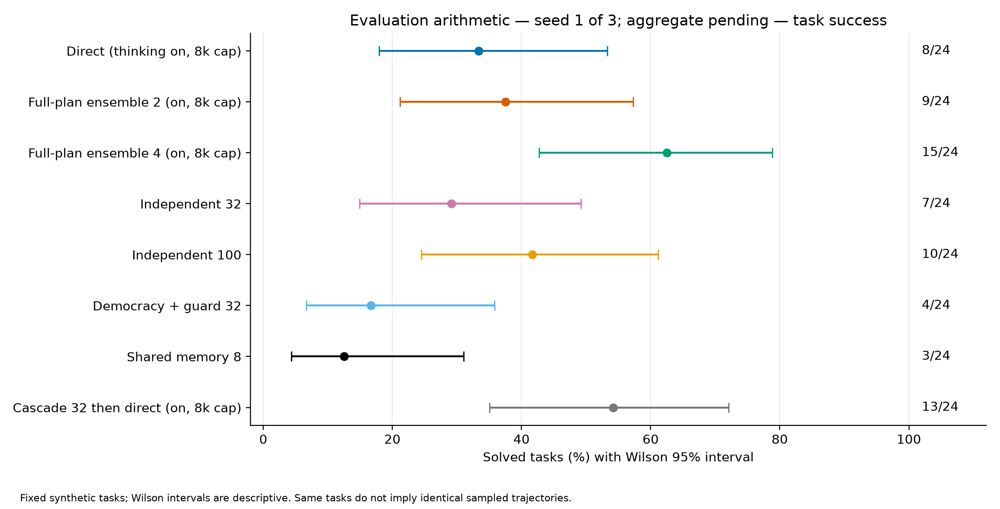

# Evaluation progress — seed 1 of 3, aggregate pending

This is an interim record for [spark-swarm-lab](https://github.com/knapcio/spark-swarm-lab). Only the first completed **arithmetic** cohort is reported here: **24 evaluation tasks × 8 frozen arms = 192 cases**, seed 1. The final three-seed, task-clustered aggregate is pending. These observations do not select or change a method, prompt, budget or configuration, and no winner is declared.

## Frozen protocol and scope

The [selection record](EVALUATION_SELECTION.json) was frozen at **2026-11-15 14:05:32 UTC**, before this cohort started at **14:07:45 UTC**. Producer source: `736ee1e9ab4a1b1ef534be587fe967c307c485e6`. The seven captured source hashes match both the final hashes and the frozen producer files. Public dataset SHA-256: `434830c439ceb286947d373df9bea1dff60da28aa83f9164e4335be4f6658398`.

Each case has a 1280-call / 32,768-completion-token ceiling, five rounds and a 180-second controller deadline. Full-plan thinking uses an 8192-token response cap; cheap step calls use 192, temperature 0.8. Cascade 32 first tries cheap independent rounds and, if unsolved, one original-task full plan. Democracy includes the preselected exact-target guard. Stop-on-verified-solution and server-counter capture are enabled.

Four persistent job slots each own one Spark/endpoint. A task's rotated arms run sequentially on its assigned node, with at most 25 simultaneous requests per endpoint. N100 is a logical path count that includes queued calls. This measures task-solving quality, occupied case latency and observed costs; **it is not a saturated-fleet throughput comparison**. Whole mixed-arm queue wall was **2187.770924 seconds** and cannot be assigned to individual arms.

## Interim arithmetic results

Every denominator below is 24 tasks at seed 1. Wilson intervals describe this one seed's task outcomes only; the final report will retain all seeds within task clusters rather than treating 72 repeated task/seed cases as 72 independent tasks. Case wall includes controller, metrics and drain overhead, and is measured across all cases, not only successes.

| Arm | Solved | Wilson 95% | Median wall s | p95 wall s | Length finishes |
|---|---:|---:|---:|---:|---:|
| Direct (thinking on, 8k) | 8/24 | 18.0–53.3% | 66.742 | 70.974 | 16 |
| Full-plan ensemble 2 (on, 8k) | 9/24 | 21.2–57.3% | 87.384 | 93.408 | 28 |
| Full-plan ensemble 4 (on, 8k) | 15/24 | 42.7–78.8% | 84.782 | 129.918 | 36 |
| Independent 32 | 7/24 | 14.9–49.2% | 5.493 | 9.831 | 0 |
| Independent 100 | 10/24 | 24.5–61.2% | 14.748 | 25.527 | 1 |
| Democracy + guard 32 | 4/24 | 6.7–35.9% | 16.960 | 28.971 | 3 |
| Shared memory 8 | 3/24 | 4.3–31.0% | 3.609 | 6.456 | 1 |
| Cascade 32 then direct (on, 8k) | 13/24 | 35.1–72.1% | 63.092 | 78.982 | 15 |

Length finishes count capped responses, not independently proven incorrect answers. Full raw outputs, failed attempts and partial traces remain in the export. The single seed and fixed synthetic construction distribution limit generalization; statistical comparisons across all planned seeds have not been run.

## Cost accounting

The controller can terminate siblings after one verified solution. Completed-client usage then omits unfinished work; starred client prompt/output totals are **lower bounds**. Calls count dispatched `request_start` events, including requests whose final response was cancelled. Server snapshots and idle/drain checks were independently recomputed and are valid for **24/24 cases in every arm, 192/192 overall**; server totals below therefore cover this entire cohort. No unknown server case is replaced with zero.

| Arm | Calls | Client prompt | Client completion | Unfinished calls | Server prompt | Server completion |
|---|---:|---:|---:|---:|---:|---:|
| Direct (on, 8k) | 24 | 3,970 | 176,475 | 0 | 3,970 | 176,475 |
| Full-plan ensemble 2 | 48 | 6,469* | 268,976* | 9 | 7,940 | 304,030 |
| Full-plan ensemble 4 | 96 | 8,419* | 352,677* | 45 | 15,880 | 525,569 |
| Independent 32 | 2751 | 317,410* | 38,535* | 150 | 320,630 | 38,929 |
| Independent 100 | 7603 | 899,435* | 109,697* | 250 | 905,545 | 110,376 |
| Democracy + guard 32 | 5696 | 1,435,232 | 93,253 | 0 | 1,435,232 | 93,253 |
| Shared memory 8 | 752 | 91,187 | 11,356 | 0 | 91,187 | 11,356 |
| Cascade 32 | 2727 | 333,157 | 158,929 | 0 | 333,157 | 158,929 |

Input and output tokens are distinct accounting quantities, not equal GPU-cost units. The output-cost figure uses completed-client usage and marks lower bounds; use the server columns when assessing cancelled work. No case deadline, budget denial or controller error was recorded. Completed worker `run_end` records report zero infrastructure failures; **41 early-stopped cases have no final worker infrastructure count**, which remains unknown rather than being interpreted as a confirmed zero.

## Independent proof and provenance audit

The [audit artifact](results/evaluation-v1/arithmetic-s1/analysis/proof-cost-audit.json) and [audit script](results/evaluation-v1/arithmetic-s1/analysis/proof-cost-audit.py) record:

- **16,035 legal transitions** independently replayed using `Fraction`, preserving ordered state consumption, distinct indices and positive integer intermediate values; **403 illegal proposals** independently rejected.
- **305 root states** checked against their public task. All completed full-plan responses were checked for bounded move arrays and execution from their own original root; traced actions match the returned plan prefix. Invalid or truncated responses remain unsuccessful data.
- **128 successful reward events** checked for exact target presence and a fully replayed legal ancestry. These are successful paths/rewards, not 128 independently solved tasks. Every one of the **69 controller stops** has an earlier producer proof; the controller event is never its own proof.
- **19,697 request starts / 19,243 request ends** checked for globally unique IDs, matching request contexts, and exact summary usage, charges, errors, length finishes and budget denials. All server known flags and deltas were recomputed from raw snapshots.
- All 192 planned task/arm/seed cases, frozen arm settings, source pins, dataset hash and pre-run selection timing verified. The public task records contain only ID, split, numbers and target. Pinned runner/harness source and command/config inspection found no reference-witness or reputation input; the private reference-witness file was not opened for this audit.

The [export manifest](results/evaluation-v1/arithmetic-s1/manifest.json) covers **590 artifacts** with original/export SHA-256 and exact path/interpreter normalizations. Its schema-2 inverse audit preserves parsed values/order/types while allowing JSON/CSV formatting changes. Model/source values and script/figure bytes remain unchanged. Analysis hashes retain provenance to the original metadata and summary. No raw trace was edited and no model API was called during this audit or curation.

## Figures and data

[192-case CSV](results/evaluation-v1/arithmetic-s1/summary.csv) · [JSON](results/evaluation-v1/arithmetic-s1/summary.json) · [metadata/source pins](results/evaluation-v1/arithmetic-s1/metadata.json) · [analysis](results/evaluation-v1/arithmetic-s1/analysis/analysis.json) · [paired task outcomes](results/evaluation-v1/arithmetic-s1/analysis/paired-results.csv) · [accuracy SVG](results/evaluation-v1/arithmetic-s1/analysis/accuracy-wilson95.svg) · [cost SVG](results/evaluation-v1/arithmetic-s1/analysis/success-vs-completion-cost.svg) · [latency SVG](results/evaluation-v1/arithmetic-s1/analysis/case-latency.svg).

Coding and subsequent-seed cohorts will be added only after each has completed and been audited. The separate supplementary solo-refinement protocol was requested before evaluation outcomes and is not included in this primary table. All settings remain frozen; this interim file is reporting progress, not informing further selection.

## Coding instrumentation repair and cohort validity

The entire original **108-case coding seed-1 cohort** is retained as diagnostic data and **excluded from primary aggregation**. A controller process-exit race and grader classification of unbounded-memory candidate processes required instrumentation repairs. The full coding protocol is being rerun uniformly from source `6c9dfe8` for **all three seeds**, including every arm and task rather than selected failed cases. Model policies, datasets, prompts and budgets are unchanged. This note records the validity decision, not new coding scores or a winner claim.

Published repair tags are `evaluation-infra-v1`, `solo-control-infra-v1` and `throughput-infra-v1`. Final aggregation must use the maintained cohort ledger with `aggregate_evaluation.py --ledger ...`: excluded/invalid entries are rejected, and each included entry must confirm matching domain/seed/source, completed case count, successful completion and unchanged sources. Fixed coding directory names are accepted explicitly by ledger identity; curated aliases resolve their original identity through their export manifest. Missing server cost remains unknown, and all task seeds remain together in the final task-cluster bootstrap.
