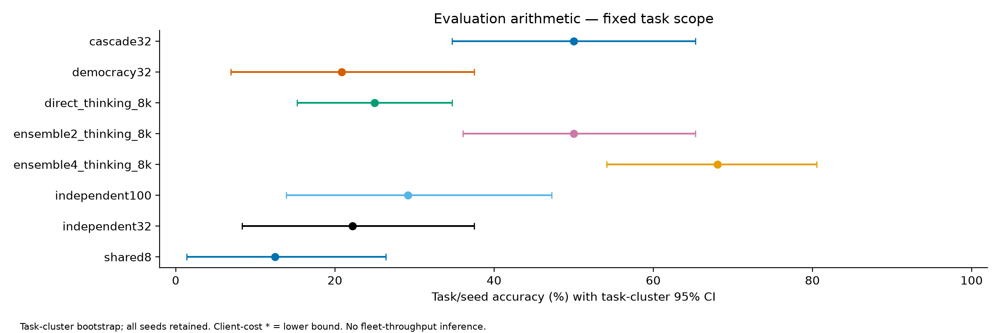
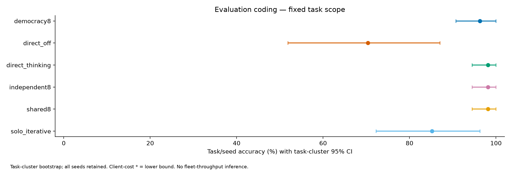
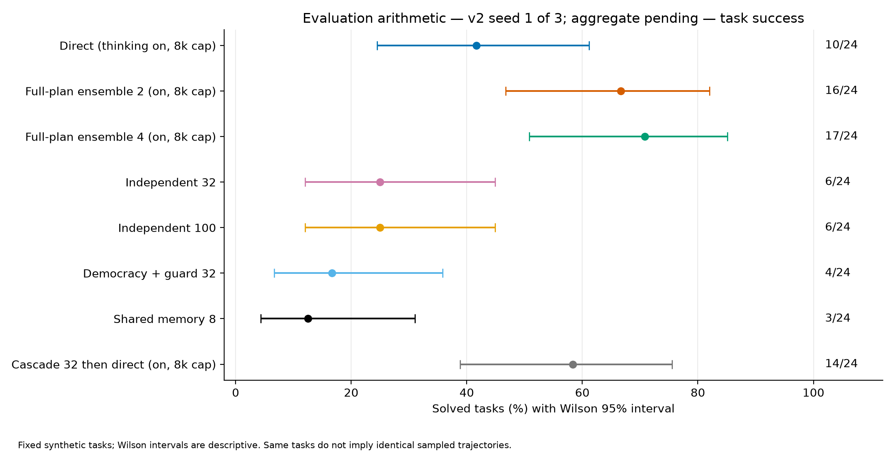
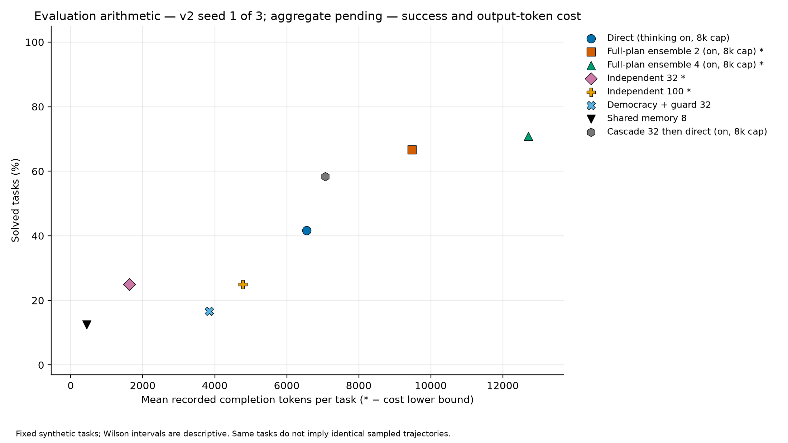
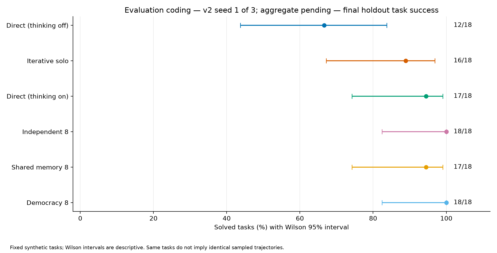
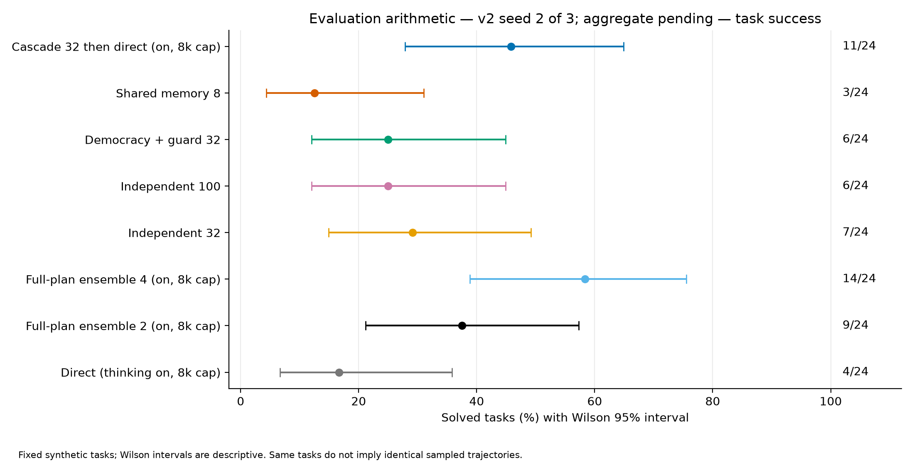
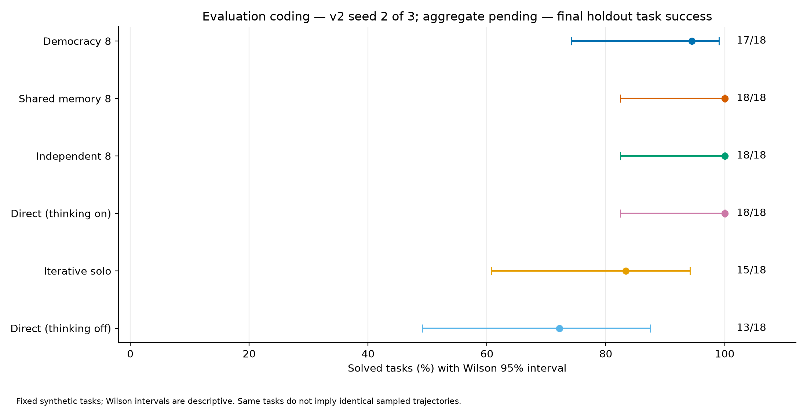
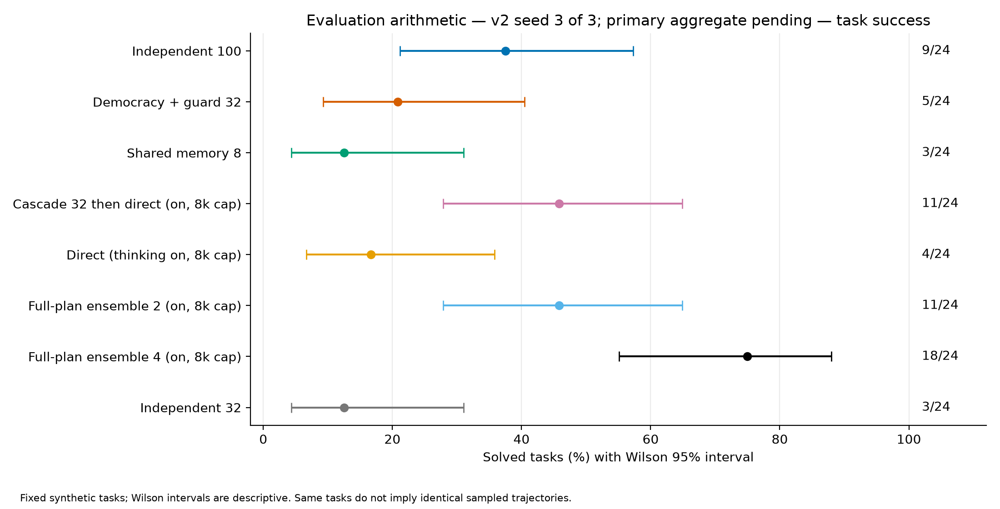
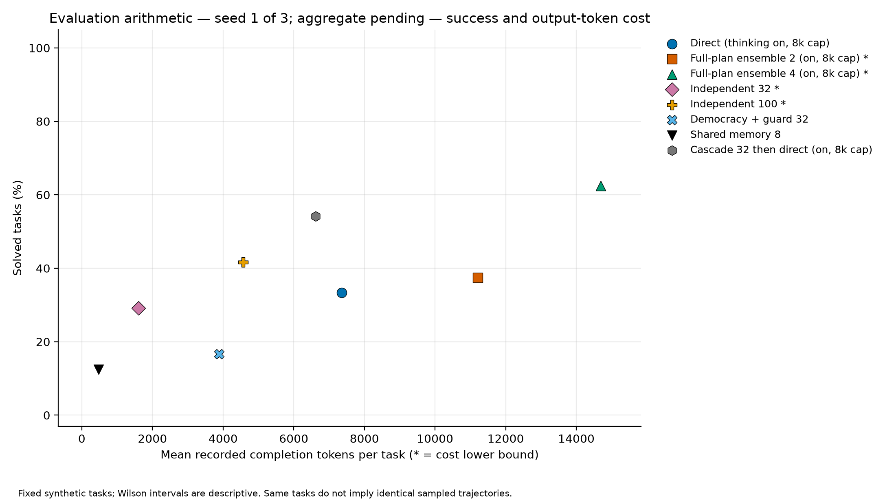

# Evaluation progress — primary, solo, throughput and coding confirmation complete

All **900 runtime-v2 primary cases are verified and independently audited**: arithmetic 576/576 and coding 324/324. The following three-seed results use only the six complete amended-runtime cohorts. The separate **80 supplementary solo attempts** and their final task-clustered aggregate are complete, as are **45 corrected loaded-throughput cohorts / 2,016 attempts**. These measurements expose quality, latency and cost tradeoffs; they do not establish a universal efficiency winner.

**Coding confirmation complete:** the separate outer-parent regrade completed **824 unique jobs for 324 cases / 323 selected artifacts**. All original-holdout outcomes agree: **295 passes, 28 failures and one no-candidate failure**. Public examples and posthoc robustness are separate phases, not replacement scores. The [confirmation analysis](results/coding-confirmation-v1-analysis/NOTES.md) and [paired CSV](results/coding-confirmation-v1-analysis/paired-holdout.csv) preserve that comparison. The original same-interpreter forgery and finite nesting-coverage gap remain demonstrated limitations; static triage found no obvious historical exploitation. [Audit and limits](CORRECTNESS_AUDIT.md).

The original [direct-assignment graph-search study](SEARCH_SELECTION.json) is complete: **0/252 core evaluation cases and 0/288 extended 64-call cases solved**. Across development and evaluation, 568 cases used 22,912 model calls, including reviewer reuse and ordinary/quality-weighted voting. Independent replay checked every one of 22,422 assignment proofs; malformed cardinality/domain responses were genuine candidate failures. The separately budgeted CPU controls solved 30/36 evaluation cases with min-conflicts and 18/36 with genetic search. [Independent audit](results/csp-independent-audit-20261116/FINAL_AUDIT.json).

In the separate [reusable-program experiment](PROGRAM_SEARCH_SELECTION.json), Nemotron wrote Python solvers scored only on four development graphs. Four independent chains selected programs solving **47/48 original evaluation outcomes**, compared with **29/48** for sequential refinement, at 16 training calls per program. These are **four paired trained programs per method on 12 reused graphs**, with wide uncertainty; generating a program and executing it on CPU is a different workflow from emitting assignments. [Completed report and figures](results/program-search-v1-analysis/REPORT.md) · [independent protocol audit](results/program-search-v1-audit/NOTES.md). Prospectively planned confirmation on **96 new graphs** is now complete: **376/384 (97.92%)** for independent chains and **237/384 (61.72%)** for sequential refinement. Three independent-chain programs each solve **96/96**; all eight sources were frozen before these 768 CPU-only grades, with zero extra model calls or repairs. [Fresh confirmation report, cost scope and figures](results/program-confirmation-v1-analysis/REPORT.md) · [independent audit](results/program-confirmation-v1-audit/AUDIT.json). The late exploratory reasoning-enabled assignment cohort also completed **0/96**: all **1,464 assignment calls** exhausted the 4,096-token cap in separate reasoning and returned no answer content; 72 review calls completed normally. This is an observed output-budget/format failure for this configuration, not evidence of general inability to color graphs. [Exact completed audit](results/csp-thinking-on16-late-audit-20261116/FINAL_AUDIT.json). Earlier assignment results remain unchanged.

A separate [program-context reviewer experiment](https://github.com/knapcio/spark-swarm-lab/blob/program-review-elites4-v1.1/PROGRAM_REVIEW_ELITES.md) is running with four training seeds and 16 calls per episode (ten program proposals and six reviews). Its pre-call phase-stop defect was fixed and independently audited before any variant calls; [audit](results/program-review-precall-audit-20261116/PRECALL_AUDIT.json).

Accuracy is the equally weighted mean of each task's three seed outcomes. The 95% percentile bootstrap resamples **task clusters**, retaining all three seeds (5000 repetitions, fixed bootstrap seed 20261115): 24 arithmetic tasks and 18 coding tasks, rather than treating repeated seeds as independent tasks. All 28 arithmetic and 15 coding paired contrasts match task/seed and use the same clustered design. Their intervals are pointwise and unadjusted for multiple comparisons. These finite synthetic corpora limit generalization.

All primary cases use the frozen source `cbcde299716b7842536b008880a089590e9816f8`, pinned vLLM 0.32.0 DSpark runtime and amended CPU grader. Prior v1 outcomes had already been inspected before the infrastructure restart: these are fresh executions of the frozen corpora, **not newly unseen evaluation data**. No method, prompt, corpus or budget was selected again from v2 outcomes.

### Complete primary arithmetic

24 fixed tasks × three seeds × 8 arms. Each arm has 72 task/seed observations, clustered into 24 tasks for uncertainty.

| Arm | Solved | Accuracy; task-cluster 95% | Calls | Server prompt | Server completion | Median / p95 wall s |
|---|---:|---:|---:|---:|---:|---:|
| Direct (thinking ON, 8k) | 18/72 | 25.0%; 15.3–34.7% | 72 | 11,910 | 516,134 | 68.945 / 74.154 |
| Full-plan ensemble 2 (ON, 8k) | 36/72 | 50.0%; 36.1–65.3% | 144 | 23,820 | 964,324 | 86.694 / 96.295 |
| Full-plan ensemble 4 (ON, 8k) | 49/72 | 68.1%; 54.2–80.6% | 288 | 47,640 | 1,631,105 | 94.361 / 131.402 |
| Independent 32 (OFF) | 16/72 | 22.2%; 8.3–37.5% | 8,456 | 996,867 | 120,068 | 6.442 / 11.248 |
| Independent 100 (OFF) | 21/72 | 29.2%; 13.9–47.2% | 23,501 | 2,815,532 | 337,541 | 15.304 / 27.703 |
| Democracy + guard 32 (OFF) | 15/72 | 20.8%; 6.9–37.5% | 16,672 | 4,104,896 | 271,720 | 17.176 / 30.904 |
| Shared memory 8 (OFF) | 9/72 | 12.5%; 1.4–26.4% | 2,256 | 273,359 | 32,725 | 3.743 / 6.084 |
| Cascade 32 then direct ON/8k | 36/72 | 50.0%; 34.7–65.3% | 8,424 | 1,026,895 | 509,325 | 69.245 / 83.156 |

[Aggregate CSV](results/evaluation-v2/primary-aggregate/arithmetic/summary.csv) · [all paired contrasts](results/evaluation-v2/primary-aggregate/arithmetic/paired-deltas.csv) · [paired task/seed outcomes](results/evaluation-v2/primary-aggregate/arithmetic/paired-cases.csv) · [success-by-time CSV](results/evaluation-v2/primary-aggregate/arithmetic/success-by-time.csv) · [time curve SVG](results/evaluation-v2/primary-aggregate/arithmetic/success-by-time.svg) · [client-cost SVG](results/evaluation-v2/primary-aggregate/arithmetic/success-vs-client-output-cost.svg) · [full provenance](results/evaluation-v2/primary-aggregate/arithmetic/analysis.json).

### Complete primary coding

18 fixed tasks × three seeds × 6 arms. Each arm has 54 task/seed observations, clustered into 18 tasks for uncertainty.

| Arm | Solved | Accuracy; task-cluster 95% | Calls | Server prompt | Server completion | Median / p95 wall s |
|---|---:|---:|---:|---:|---:|---:|
| Direct (OFF) | 38/54 | 70.4%; 51.9–87.0% | 54 | 13,479 | 5,699 | 5.038 / 9.629 |
| Iterative solo (OFF) | 46/54 | 85.2%; 72.2–96.3% | 75 | 24,433 | 8,363 | 5.553 / 10.339 |
| Direct (thinking ON) | 53/54 | 98.1%; 94.4–100.0% | 54 | 13,479 | 155,364 | 23.759 / 61.884 |
| Independent 8 | 53/54 | 98.1%; 94.4–100.0% | 456 | 121,589 | 50,512 | 6.987 / 16.956 |
| Shared memory 8 | 53/54 | 98.1%; 94.4–100.0% | 448 | 125,832 | 50,963 | 6.799 / 15.928 |
| Democracy 8 | 52/54 | 96.3%; 90.7–100.0% | 896 | 586,792 | 76,408 | 20.279 / 34.976 |

[Aggregate CSV](results/evaluation-v2/primary-aggregate/coding/summary.csv) · [all paired contrasts](results/evaluation-v2/primary-aggregate/coding/paired-deltas.csv) · [paired task/seed outcomes](results/evaluation-v2/primary-aggregate/coding/paired-cases.csv) · [success-by-time CSV](results/evaluation-v2/primary-aggregate/coding/success-by-time.csv) · [time curve SVG](results/evaluation-v2/primary-aggregate/coding/success-by-time.svg) · [client-cost SVG](results/evaluation-v2/primary-aggregate/coding/success-vs-client-output-cost.svg) · [full provenance](results/evaluation-v2/primary-aggregate/coding/analysis.json).

### Cost, latency and interpretation

The server columns cover **900/900 cases**, with independently reconciled before/after counters and idle/drain boundaries; they include stopped sibling work. Prompt and completion tokens are separate accounting quantities, not equivalent units of GPU work. Full-plan ensemble client usage omits cancelled siblings: completed-client totals are lower bounds for 1044 unfinished arithmetic responses and two coding responses, while the known server totals above retain that work. The complete CSVs retain both accounting views and their coverage.

The recipes differ materially: arithmetic direct uses one reasoning-ON response capped at 8192 tokens, ensembles allow two or four such full plans, and Independent100 uses up to100 short OFF/192 paths over rounds, queued behind a 25-request engine cap. They share a 32768-completion-token case ceiling, not equal consumed input/output or reasoning settings. Observed ensemble accuracy is therefore a result for these complete recipes, not an isolated effect of agent count. The stronger sequential solo control completed its separate 80 attempts (eight development plus 72 evaluation); its final clustered comparison is linked below.

Occupied-case median/p95 above includes controller, metrics and drain overhead across **all cases**. The time-success curves divide successes observed by each deadline by all 72 or 54 task/seed cases; solved-only first-proof summaries are separately named in JSON. Four fixed job slots assign one endpoint each. Mixed-arm queue wall is retained per cohort and must not be converted into per-arm fleet throughput. No deadlines, budget denials, controller errors or unexpected process failures were recorded. Early-stopped arithmetic workers retain **120 unknown final infrastructure counters**, not confirmed zeros. Coding retains one kernel-confirmed candidate OOM as a model resource failure, with successful cleanup and no grader infrastructure failure.

Coding success means the selected frozen candidate passed its single final holdout: **295/324**, separate from **297/324 feedback-pass cases**. There are 323 holdout grades; one no-candidate case remains unsolved in the full denominator and its absent holdout/test totals remain unknown. Selection precedes holdout, with no holdout-driven model retry. Independent outer-parent confirmation reproduced all 324 binary outcomes, without replacing historical grades or establishing universal resistance to malicious interpreter tampering.

The [complete primary ledger](results/evaluation-v2/primary-aggregate/verified-ledger.json), [source/configuration record](results/evaluation-v2/primary-aggregate/source-configurations.json), [24-artifact export manifest](results/evaluation-v2/primary-aggregate/manifest.json), [independent aggregate audit](results/evaluation-v2/primary-aggregate/aggregation-audit.json) and [audit script](results/evaluation-v2/primary-aggregate/audit.py) preserve dataset/source/runtime hashes and exact path/interpreter normalizations. Original ledger/input SHA references deliberately remain original hashes; the manifest maps them to normalized export hashes. CSVs, figures and captured model/source values are unchanged. Both accuracy PNGs received independent visual QA. No model API or active/frozen source change was used for analysis.

## Completed supplemental solo and loaded-throughput comparisons

Sequential own-plan refinement solved **45/72 (62.5%; task-cluster 95% interval 47.2–77.8%)**. Four independent full plans solved 49/72; the paired difference is **+5.56 percentage points, 95% interval −5.56 to +16.67**. This pointwise interval spans zero. The methods retain separate schedules, source variants and actual costs. [Complete comparison and figures](results/solo-control-v2/complete-comparison/solo-comparison/REPORT.md).

All **45 timeout-corrected queue cohorts** passed: 36 development batches of 32 attempts and nine evaluation batches of 96, totaling **2,016 attempts**. Development chose admission from 1/2/4/8 cases per node before evaluation. Shared frontier 8 recorded **12/96 at 21.31 successful attempts/minute**; four full plans recorded **48/96 at 2.87/minute**. These are different quality/rate tradeoffs, not an overall winner. Rate uses one finite full-batch wall including final drain, so there is no rate CI; success intervals cluster the 24 tasks and retain four seeds. The bounded admission sweep is not a globally saturated solo optimum, and the four cheap-policy arms remain a later exploratory amendment. [Completed throughput report](results/throughput-timeoutguard-20261115/REPORT.md) · [evaluation CSV](results/throughput-timeoutguard-20261115/evaluation/summary.csv) · [hash manifest](results/throughput-timeoutguard-20261115/manifest.json).

## Historical snapshot — supplementary sequential solo, seed 1 of 3

The per-seed records below preserve earlier measurements and analysis stages. Pending/deferred statements refer to those historical snapshots; the completed aggregates above supersede their completion status. No historical outcome or artifact is rewritten.

This first cohort of the separate [supplemental control](EVALUATION_SOLO_CONTROL.json), frozen before primary outcomes, contains **24/24 independently audited cases**, seed 1, source `a8adff19f690e90aec5705c373a82005e869f1f2`. It is not added to the original 900-case matrix or pooled with the eight-task [development smoke](results/solo-control-v2/development-s1/). At this snapshot, the final clustered control aggregate and loaded-fleet comparison were pending.

One agent may revise its own full plan up to four times, thinking ON/8192 per response, under the same 32768-completion-token / 1280-call ceiling and 180s controller deadline. Each revision starts from the original task and receives only its own preceding parsed plan, exact transition error and final state. The pinned source, protocol timing and feedback provenance were independently checked.

| Control | Solved | Single-seed Wilson 95% | Calls | Unfinished | Server prompt | Server completion | Median / p95 occupied wall s |
|---|---:|---:|---:|---:|---:|---:|---:|
| Sequential own-plan refinement | 16/24 | 46.7–82.0% | 52 | 8 | 10,709 | 347,511 | 131.260 / 181.887 |

All eight unsolved cases reach the controller deadline. Their unfinished calls make completed-client usage **8789 prompt / 302782 completion tokens a lower bound**, while server counter costs are independently known for **24/24** cases. Eight final worker infrastructure counters remain unknown; no controller error, unexpected process failure or budget denial is recorded. There are 26 length finishes and 27 request-format errors (26 `ValueError`, one `JSONDecodeError`), retained as observed outcomes. Occupied wall includes controller/metrics/drain overhead, so its p95 can exceed the 180s worker cutoff. Whole queue wall is 876.060994s and is not an individual-arm fleet-throughput rate.

The [audit](results/solo-control-v2/evaluation-s1/analysis/proof-cost-audit.json) and [script](results/solo-control-v2/evaluation-s1/analysis/proof-cost-audit.py) check 52 original roots, 42 legal Fraction transitions, one independently rejected illegal proposal, all 16 successful ancestries, own-feedback revision order, 52 starts/44 ends, usage/charges/caps and server deltas. The [82-artifact manifest](results/solo-control-v2/evaluation-s1/manifest.json) passes independent original/export SHA and parsed inverse checks, including the [verified ledger receipt](results/solo-control-v2/evaluation-s1/analysis/verified-ledger-entry.json). [24-case CSV](results/solo-control-v2/evaluation-s1/summary.csv) · [source/runtime metadata](results/solo-control-v2/evaluation-s1/metadata.json) · [derived interim analysis](results/solo-control-v2/evaluation-s1/analysis/summary-derived/analysis.json). No partial seed 2/3 outcomes, model API or active/frozen source changes were used.

## Historical snapshot — supplementary sequential solo, seed 2 of 3

This second independently verified cohort has **24/24 cases**, source `a8adff19`, unchanged frozen control and runtime. It solves **14/24** (single-seed Wilson 95% 38.8–75.5%); all ten unsolved cases hit the 180s controller deadline. It remains separate from the original 900-case matrix and eight-task development smoke; at this snapshot, three-seed control aggregation and loaded-fleet comparisons were pending. No seed 3 partial outcomes were read.

The [audit](results/solo-control-v2/evaluation-s2/analysis/proof-cost-audit.json) checks 51 original-task roots, 36 legal Fraction transitions, all 14 proof-backed successes, own-feedback revision order and 51 starts/41 ends. Ten unfinished calls make client **8083 prompt / 281967 completion** a lower bound. Server costs cover **24/24** cases: **10,503 prompt / 334,786 completion**. Ten final worker infrastructure counters stay unknown; there is no controller error, unexpected process failure or budget denial. There are 27 length finishes and 27 parser-error events. Median/p95 occupied wall is 111.285/181.225s including metrics/drain; separate queue wall is 1010.708336s, not a per-arm fleet-throughput rate.

The [82-artifact manifest](results/solo-control-v2/evaluation-s2/manifest.json) and [verified receipt](results/solo-control-v2/evaluation-s2/analysis/verified-ledger-entry.json) pass original/export SHA and independent parsed-inverse checks. [24-case CSV](results/solo-control-v2/evaluation-s2/summary.csv) · [source/runtime metadata](results/solo-control-v2/evaluation-s2/metadata.json) · [interim summary](results/solo-control-v2/evaluation-s2/analysis/summary-derived/analysis.json). No model API, remote execution or active/frozen source edit was used.

## Historical snapshot — supplementary sequential solo, seed 3 of 3

The final cohort is **24/24 verified and independently audited**, source `a8adff19`. It solves **15/24** (single-seed Wilson 95% 42.7–78.8%), with nine unsolved deadline cases. All 80 supplemental attempts are complete (eight development plus 72 evaluation); development is never pooled with evaluation. At this snapshot, task-clustered control aggregation was deliberately deferred until after the loaded-throughput window.

The [audit](results/solo-control-v2/evaluation-s3/analysis/proof-cost-audit.json) replays 41 legal Fraction transitions, independently rejects two illegal proposals, verifies 47 original roots and all 15 successful ancestries, and checks sequential own-feedback/protocol/source/budget provenance. There are 47 starts/38 ends and nine unfinished responses. Client **7438 prompt / 253118 completion** is a lower bound; all 24 server costs are known: **9630 prompt / 298367 completion**. Nine final worker infrastructure counters remain unknown; there is no controller error, unexpected process failure or budget denial. Twenty-one length finishes and 21 parser-error events are retained. Median/p95 occupied wall is 96.466/182.927s including controller/drain; separate queue wall is 844.424475s. Neither is repurposed as a per-arm fleet-throughput rate.

The [82-artifact manifest](results/solo-control-v2/evaluation-s3/manifest.json) and [verified receipt](results/solo-control-v2/evaluation-s3/analysis/verified-ledger-entry.json) pass independent original/export SHA and semantic-inverse checks. [24-case CSV](results/solo-control-v2/evaluation-s3/summary.csv) · [source/runtime metadata](results/solo-control-v2/evaluation-s3/metadata.json) · [interim analysis](results/solo-control-v2/evaluation-s3/analysis/summary-derived/analysis.json). This lightweight audit made no model/remote calls and generated no bootstrap/plots during loaded throughput.

## Runtime-v2 protocol and historical interim records

The [runtime-v2 amendment](RUNTIME_V2_AMENDMENT.json) requires **all 900 primary cases** to execute fresh under the qualified v0.32.0 serving image: 576 arithmetic cases (24 tasks × 8 arms × 3 seeds) and 324 coding cases (18 tasks × 6 arms × 3 seeds), plus a separate 80 supplementary solo attempts. **No runtime-v1 or partial rows, including the original arithmetic seed 1 below, are pooled into v2.** Earlier reports remain public historical/diagnostic records. Prior v1 outcomes were already inspected; the disclosed infrastructure amendment leaves the preselected methods, prompts, datasets, seed lists and budgets unchanged.

The [single-node qualification evidence](SERVING.md) and [141-artifact export](results/serving-v032-20261115/manifest.json) cover matched c25 repeats, old/new diagnostic replays, short-JSON/tool probes and a reasoning-on exact-plan smoke. The observed +1.60% median serving difference is not a robust speedup or proven crash fix. At that qualification stage, fleet deployment was pending. Initial serving-only source tags `evaluation-runtime-v2` (`114e17f`), `solo-control-runtime-v2` (`2825e5f`) and `throughput-runtime-v2` (`216a9f3`) preserve the state before the CPU environment amendment below.

Before any v2 primary model calls, the [CPU grader environment amendment](CPU_GRADER_AMENDMENT.json) changes the pinned image and Python/compiler/libc versions, retaining stdlib grader logic, isolation, model policies, prompts, budgets and corpora. [357 trusted-reference cases in 48 phase containers plus three smoke validations](results/cpu-grader-20261115/cpu-python-grader-validation.json) pass, with zero owned leftovers on four nodes. The [initial trusted-reference invocation failure](results/cpu-grader-20261115/cpu-python-grader-reference-import-diagnostic.json) is preserved; it was corrected by supplying existing module imports `re`/`Counter` to trusted function fragments, without editing model source or tests. This finite validation does not establish universal environment equivalence.

The CPU-amended source tags at that stage were `evaluation-runtime-v2.1` (`cbcde299`), `solo-control-runtime-v2.1` (`a8adff19`) and `throughput-runtime-v2.1` (`47bba9f0`). Actual coding jobs use the new Python image; arithmetic-only snapshots can retain an unused historical grader file for strict byte identity. The later completed loaded study uses timeout-corrected source `7bb965b073af8cdc211404186c15463d5cfc374e`; see the [transport amendment](TRANSPORT_TIMEOUT_AMENDMENT.json). No v2 primary calls preceded the CPU amendment. The retirement receipt's 65,945,247,744-byte value is available space after the operation, not a reclaimed-byte delta.

## Historical snapshot — runtime-v2 primary execution started

The [four-replica health/idle gate](results/runtime-v2-fleet-qualification/health-receipt.json) passed at **2026-11-15 16:46:18 UTC**, with [matching pinned image/commands](results/runtime-v2-fleet-qualification/serving-inspection.json). Fresh primary generation was authorized at **16:49:07 UTC (17:49:07 Europe/Warsaw)**. The primary phase is complete; all 900 primary cases and the separate 80 supplementary solo attempts belong to the amended environment, with no old/partial cohort pooling.

The separate [serving qualification](SERVING.md) completed 416 requests, including warmups, with 69,158 completion tokens in 39.008007 full-wall seconds (1772.918 tok/s), zero recorded transport errors and sampled peaks of 25 running requests per endpoint. Its [13 original reports](results/runtime-v2-fleet-qualification/manifest.json) and [audit](results/runtime-v2-fleet-qualification/qualification-audit.json) are serving diagnostics, not primary task-quality outcomes or a causal comparison with earlier measurements.

Each primary cohort was read for quality analysis only after completion and an explicit `verified:true` receipt in the v2 ledger. The reports below preserve their original interim seed/scope evidence; their pending statements refer to the historical snapshot, and completed primary/solo/throughput aggregates are above. Supplementary controls and loaded-fleet measurements remain separate, with no overall efficiency winner declared.

## Historical snapshot — completed v2 arithmetic, seed 1 of 3 before aggregation

This completed cohort contains **24 tasks × 8 frozen arms = 192 cases**, seed 1. Its [ledger receipt](results/evaluation-v2/arithmetic-s1/analysis/verified-ledger-entry.json) has `verified:true`, `valid_for_aggregation:true`, return code 0, complete case coverage and unchanged sources. Producer `cbcde299716b7842536b008880a089590e9816f8` and all seven captured source hashes match the final hashes, frozen files and commit blobs. Runtime SHA-256 is `072b628126f36aa559fa864372118c7e0497e44d1b37d29be99ea3c7f8cf6ec5`, with vLLM v0.32.0, the pinned target/draft and the amended CPU-grader metadata. The public task dataset and predeclared arm list are unchanged; no witness/oracle input was supplied.

Each case retains the 1280-call / 32,768-completion-token ceiling, five rounds and 180-second deadline. Full-plan calls use thinking ON/8192; cheap calls use OFF/192, at temperature 0.8. Four fixed slots own one endpoint each; arm order rotates per task. Whole mixed-arm queue wall is **2169.859601s**, separate from per-case wall and unsuitable for calculating per-arm fleet throughput.

The table follows the predeclared arm order. Wilson intervals describe these 24 single-seed task outcomes only. Final comparisons will retain all seeds within task clusters after the full verified primary study and supplementary controls; this interim table declares no winner and is not pooled with v1.

| Arm | Solved | Wilson 95% | Median wall s | p95 wall s | Length finishes |
|---|---:|---:|---:|---:|---:|
| Direct (thinking on, 8k) | 10/24 | 24.5–61.2% | 62.855 | 72.452 | 13 |
| Full-plan ensemble 2 (on, 8k) | 16/24 | 46.7–82.0% | 78.928 | 95.094 | 17 |
| Full-plan ensemble 4 (on, 8k) | 17/24 | 50.8–85.1% | 93.804 | 131.056 | 28 |
| Independent 32 | 6/24 | 12.0–44.9% | 6.286 | 10.165 | 2 |
| Independent 100 | 6/24 | 12.0–44.9% | 14.519 | 28.453 | 3 |
| Democracy + guard 32 | 4/24 | 6.7–35.9% | 17.176 | 31.025 | 3 |
| Shared memory 8 | 3/24 | 4.3–31.0% | 3.528 | 6.123 | 0 |
| Cascade 32 then direct (on, 8k) | 14/24 | 38.8–75.5% | 67.927 | 83.726 | 12 |

### Observed v2 seed-1 costs

All **192/192 server costs** are independently confirmed from idle endpoint counter deltas, including stopped sibling work. Completed-client totals marked * are lower bounds because some responses were stopped. Tokens measure observed usage, not equal GPU-cost units; server totals cover 24/24 cases per arm.

| Arm | Calls | Client prompt | Client completion | Unfinished calls | Server prompt | Server completion |
|---|---:|---:|---:|---:|---:|---:|
| Direct (on, 8k) | 24 | 3,970 | 157,198 | 0 | 3,970 | 157,198 |
| Full-plan ensemble 2 | 48 | 5,452* | 227,325* | 15 | 7,940 | 307,774 |
| Full-plan ensemble 4 | 96 | 7,426* | 305,085* | 51 | 15,880 | 530,381 |
| Independent 32 | 2794 | 323,199* | 38,996* | 141 | 330,403 | 39,803 |
| Independent 100 | 7976 | 953,469* | 114,734* | 150 | 955,443 | 114,968 |
| Democracy + guard 32 | 5696 | 1,396,896 | 92,356 | 0 | 1,396,896 | 92,356 |
| Shared memory 8 | 736 | 89,239 | 10,626 | 0 | 89,239 | 10,626 |
| Cascade 32 | 2811 | 342,644 | 169,743 | 0 | 342,644 | 169,743 |

No deadline, budget denial, controller error or unexpected process error was recorded. Retained request-format/parser errors comprise **96 `JSONDecodeError` and 68 `ValueError` events**; these are request events rather than case counts. Available final worker infrastructure counts sum to zero, while **44 early-stopped cases have an unknown final worker count**. Unknown counts stay null; expected negative controller-stop exits remain distinct from process failures.

### Independent v2 seed-1 audit and files

The [audit](results/evaluation-v2/arithmetic-s1/analysis/proof-cost-audit.json) and [replay script](results/evaluation-v2/arithmetic-s1/analysis/proof-cost-audit.py) independently checked **16,692 legal `Fraction` transitions**, 365 illegal proposal flags, 307 original-task roots, bounded full-plan response prefixes and all successful legal ancestries. The **131 successful path/reward events** can include several paths within one case. Every successful controller stop has an earlier producer proof. All **20,181 request starts / 19,824 ends** reconcile by unique ID, context, usage, reservation settlement, caps and case budgets. Case commands, selection/amendment timing and source/runtime/grader metadata pins were also checked.

The [manifest](results/evaluation-v2/arithmetic-s1/manifest.json) covers **592 original/derived artifacts** with original/export SHA-256, exact path/interpreter edits and parsed inverse audits. Raw case files are unchanged. Model outputs, failed attempts, reasoning and incomplete-response costs remain present. The completed ledger entry is captured separately with its [normalization audit](results/evaluation-v2/arithmetic-s1/analysis/verified-ledger-entry-normalizations.json); no unfinished cohort's outcomes were read for this report. No model API or active/frozen source edit was performed during curation.

[192-case CSV](results/evaluation-v2/arithmetic-s1/summary.csv) · [metadata/source pins](results/evaluation-v2/arithmetic-s1/metadata.json) · [analysis](results/evaluation-v2/arithmetic-s1/analysis/analysis.json) · [paired task outcomes](results/evaluation-v2/arithmetic-s1/analysis/paired-results.csv) · [accuracy SVG](results/evaluation-v2/arithmetic-s1/analysis/accuracy-wilson95.svg) · [cost SVG](results/evaluation-v2/arithmetic-s1/analysis/success-vs-completion-cost.svg) · [latency SVG](results/evaluation-v2/arithmetic-s1/analysis/case-latency.svg).

## Historical snapshot — completed v2 coding, seed 1 of 3 before aggregation

The second reported v2 cohort contains **18 coding tasks × 6 frozen arms = 108 cases**, seed 1, with [verified complete ledger admission](results/evaluation-v2/coding-s1/analysis/verified-ledger-entry.json), return code 0 and unchanged sources. Together with arithmetic seed 1, these first two cohorts contribute **300 independently audited primary cases**; at this snapshot, the full 900-case comparison and separate supplementary controls were pending. This is a single-seed interim result, with no final winner declaration.

Source is `cbcde299716b7842536b008880a089590e9816f8`, including the amended Python3.12 CPU image and exact static grading-runner hash. All seven source hashes match the frozen files, final hashes and commit blobs. Public/private corpus SHA-256 values match the predeclared selection. The audit verifies public-example, feedback and holdout inputs are disjoint, and checks grade case counts and first-failure input/expected values against the pinned private phase data. Model prompts use public specifications/examples and permitted feedback; the holdout is graded only after candidate selection freezes.

Each case has at most 1024 calls, 131,072 completion tokens and a 180-second controller deadline. OFF calls allow 1024 tokens and the thinking baseline 8192, at temperature 0.8. Direct policies have one round; repair/search policies permit three. Each fixed endpoint/grader-host slot owns one Spark. Whole mixed-arm queue wall is **449.166428s**; per-case wall includes model work, grading and controller/drain overhead and is not per-arm fleet throughput.

| Arm | Agents | Feedback pass cases | Final task successes | Wilson 95% final | Median wall s | p95 wall s |
|---|---:|---:|---:|---:|---:|---:|
| Direct (off) | 1 | 13/18 | 12/18 | 43.7–83.7% | 5.402 | 8.807 |
| Iterative solo | 1 | 16/18 | 16/18 | 67.2–96.9% | 5.436 | 9.910 |
| Direct (thinking on) | 1 | 17/18 | 17/18 | 74.2–99.0% | 21.609 | 61.763 |
| Independent 8 | 8 | 18/18 | 18/18 | 82.4–100.0% | 8.567 | 23.225 |
| Shared memory 8 | 8 | 17/18 | 17/18 | 74.2–99.0% | 6.280 | 23.887 |
| Democracy 8 | 8 | 18/18 | 18/18 | 82.4–100.0% | 19.278 | 34.912 |

Feedback and final results remain separate: **99/108 cases pass feedback and 98/108 are final task successes**. Exactly **107 candidates are selected and each receives one holdout grade**. One direct-thinking case selects no candidate and has no feedback/holdout grade; it remains unsolved in the 18-case arm denominator, with raw grade fields null. Coverage is explicitly 17/18 for that arm and 18/18 elsewhere. Reported holdout test totals cover only available grades; an entirely ungraded group retains null totals. The offline analyzer's null-handling fix has an edge-case test preserving this denominator and unknown-grade distinction. Frozen model/harness code and raw outcomes are unchanged.

### Observed coding seed-1 costs and protocol audit

| Arm | Calls | Client prompt | Client completion | Unfinished calls | Server prompt | Server completion |
|---|---:|---:|---:|---:|---:|---:|
| Direct (off) | 18 | 4,493 | 1,927 | 0 | 4,493 | 1,927 |
| Iterative solo | 24 | 7,409 | 2,361 | 0 | 7,409 | 2,361 |
| Direct (thinking on) | 18 | 4,493 | 49,395 | 0 | 4,493 | 49,395 |
| Independent 8 | 152 | 42,006* | 18,285* | 1 | 42,243 | 18,556 |
| Shared memory 8 | 160 | 53,944 | 20,408 | 0 | 53,944 | 20,408 |
| Democracy 8 | 288 | 177,816 | 24,594 | 0 | 177,816 | 24,594 |

Server costs are independently confirmed for **108/108 cases**. Starred client usage is a lower bound because one pending response was stopped after selection. Input/output counts are observed usage rather than equal GPU-cost units. There are 660 request starts and 659 ends, two retained response-format `ValueError` and two `JSONDecodeError` events, two length finishes, and no recorded deadline, budget denial, controller error or grader infrastructure error. All 108 worker `run_end` records are present; one reports pending model work at selection. No OOM or timeout grading event occurred in this cohort; the separate CPU qualification tests cover those resource classifications.

The [independent protocol/cost audit](results/evaluation-v2/coding-s1/analysis/protocol-cost-audit.json) and [audit script](results/evaluation-v2/coding-s1/analysis/protocol-cost-audit.py) verify **295 source artifacts** against SHA-256 and their raw model responses, 247 feedback grades, 48 exact phase/code-cache reuses and 107 single holdout grades. They reconstruct private repair tracks, feedback-only shared facts, review shortlists and semantic vote tallies, and confirm no model start, repair or feedback retry after selection. The pinned grading control flow and report artifacts were audited without re-executing candidate code; adversarial grade-forgery resistance is outside this check.

The [owned-grader boundary receipt](results/evaluation-v2/coding-s1/owned-grader-boundary.json) is verified at **17:32:53 UTC**, after 6.599s, with no owned containers or local coding children remaining. The [manifest](results/evaluation-v2/coding-s1/manifest.json) covers **341 original/derived artifacts**, retaining all negative outputs, parser/grade reports, cache events, source/data hashes and raw null fields, with audited path/interpreter normalization. The [completed ledger entry normalization record](results/evaluation-v2/coding-s1/analysis/verified-ledger-entry-normalizations.json) links its canonical original and exported values. No partial seed-2 outcomes or model APIs were used for this curation.

[108-case CSV](results/evaluation-v2/coding-s1/summary.csv) · [metadata/source pins](results/evaluation-v2/coding-s1/metadata.json) · [analysis and grade coverage](results/evaluation-v2/coding-s1/analysis/analysis.json) · [paired tasks](results/evaluation-v2/coding-s1/analysis/paired-results.csv) · [accuracy SVG](results/evaluation-v2/coding-s1/analysis/accuracy-wilson95.svg) · [cost SVG](results/evaluation-v2/coding-s1/analysis/success-vs-completion-cost.svg) · [latency SVG](results/evaluation-v2/coding-s1/analysis/case-latency.svg).

## Historical snapshot — completed v2 arithmetic, seed 2 of 3 before aggregation

This third reported cohort adds **192 complete cases** (24 tasks × 8 arms), bringing the independently audited total to **492/900 primary cases**. Its [completed ledger receipt](results/evaluation-v2/arithmetic-s2/analysis/verified-ledger-entry.json) has `verified:true`, `valid_for_aggregation:true` and return code 0. Producer `cbcde299716b7842536b008880a089590e9816f8`, runtime SHA `072b628126f36aa559fa864372118c7e0497e44d1b37d29be99ea3c7f8cf6ec5` and all seven captured/final source hashes match the frozen files and commit blobs. Target/draft, serving limits, CPU-grader metadata and public dataset remain pinned. Commands contain only the declared task/seed/policy inputs, with no witness/oracle input.

The table follows the **predeclared reversed arm order for seed 2**, with task-local rotation, rather than sorting by outcomes. Limits remain 1280 calls / 32,768 completion tokens, five rounds, a 180-second deadline, ON/8192 full plans and OFF/192 cheap calls at T0.8. Four fixed job slots retain their endpoint assignments. Whole mixed-arm queue wall is **2395.950636s**, separate from occupied case wall and per-arm fleet throughput. No three-seed aggregate or winner claim is made; repeated seeds remain clustered by task in the eventual final analysis.

| Arm | Solved | Wilson 95% | Median wall s | p95 wall s | Length finishes |
|---|---:|---:|---:|---:|---:|
| Cascade 32 then direct (on, 8k) | 11/24 | 27.9–64.9% | 71.252 | 81.586 | 13 |
| Shared memory 8 | 3/24 | 4.3–31.0% | 3.614 | 5.995 | 0 |
| Democracy + guard 32 | 6/24 | 12.0–44.9% | 16.076 | 28.953 | 3 |
| Independent 100 | 6/24 | 12.0–44.9% | 16.298 | 27.359 | 2 |
| Independent 32 | 7/24 | 14.9–49.2% | 6.037 | 9.570 | 1 |
| Full-plan ensemble 4 (on, 8k) | 14/24 | 38.8–75.5% | 95.315 | 131.202 | 39 |
| Full-plan ensemble 2 (on, 8k) | 9/24 | 21.2–57.3% | 88.921 | 96.697 | 29 |
| Direct (thinking on, 8k) | 4/24 | 6.7–35.9% | 69.294 | 75.508 | 20 |

### Observed arithmetic seed-2 costs and audit

Server-counter costs are independently known for **192/192 cases**, 24/24 per arm. Starred completed-client totals are lower bounds because their responses were stopped; input/output tokens remain distinct usage quantities rather than equal GPU-cost units.

| Arm | Calls | Client prompt | Client completion | Unfinished calls | Server prompt | Server completion |
|---|---:|---:|---:|---:|---:|---:|
| Cascade 32 | 2832 | 345,072 | 173,742 | 0 | 345,072 | 173,742 |
| Shared memory 8 | 760 | 92,054 | 11,094 | 0 | 92,054 | 11,094 |
| Democracy + guard 32 | 5376 | 1,321,568 | 87,411 | 0 | 1,321,568 | 87,411 |
| Independent 100 | 8044 | 961,448* | 115,781* | 150 | 967,901 | 116,237 |
| Independent 32 | 2791 | 324,334* | 39,005* | 129 | 326,469 | 39,246 |
| Full-plan ensemble 4 | 96 | 8,935* | 391,755* | 42 | 15,880 | 599,145 |
| Full-plan ensemble 2 | 48 | 6,455* | 287,457* | 9 | 7,940 | 333,811 |
| Direct (on, 8k) | 24 | 3,970 | 183,643 | 0 | 3,970 | 183,643 |

There are no recorded deadlines, budget denials, controller errors or unexpected process errors. Request-format/parser failures remain **108 `JSONDecodeError` and 103 `ValueError` events**, separate from case outcomes. Available final worker infrastructure counts sum to zero; **36 early-stopped cases retain unknown final counts**, without zero-filling. All unsuccessful responses and cap finishes remain in the traces.

The [independent audit](results/evaluation-v2/arithmetic-s2/analysis/proof-cost-audit.json) and [replay script](results/evaluation-v2/arithmetic-s2/analysis/proof-cost-audit.py) verify **16,643 legal `Fraction` transitions**, 359 illegal proposal flags, 306 original-task roots, bounded plan prefixes, exact target rewards and complete legal proof ancestry. They reconcile **19,971 request starts / 19,641 ends**, including 330 unfinished responses, unique IDs, usage, reservation settlement, request/case caps and idle server deltas. The 101 successful path/reward events may include several paths per case; every successful controller stop has prior producer proof.

The [manifest](results/evaluation-v2/arithmetic-s2/manifest.json) covers **592 original/derived artifacts** with original/export hashes and audited path/interpreter normalizations. Model outputs, reasoning, errors, unknown counts and source hashes are retained; raw case files are unchanged. The [ledger normalization audit](results/evaluation-v2/arithmetic-s2/analysis/verified-ledger-entry-normalizations.json) preserves the canonical verified entry. No partial coding seed-2 outcome, model API or active/frozen source edit was used for this curation.

[192-case CSV](results/evaluation-v2/arithmetic-s2/summary.csv) · [metadata/source pins](results/evaluation-v2/arithmetic-s2/metadata.json) · [analysis](results/evaluation-v2/arithmetic-s2/analysis/analysis.json) · [paired task outcomes](results/evaluation-v2/arithmetic-s2/analysis/paired-results.csv) · [accuracy SVG](results/evaluation-v2/arithmetic-s2/analysis/accuracy-wilson95.svg) · [cost SVG](results/evaluation-v2/arithmetic-s2/analysis/success-vs-completion-cost.svg) · [latency SVG](results/evaluation-v2/arithmetic-s2/analysis/case-latency.svg).

## Historical snapshot — completed v2 coding, seed 2 of 3 before aggregation

This cohort adds **108 complete cases** (18 tasks × 6 arms), bringing the independently audited primary total to **600/900**. Its [ledger entry](results/evaluation-v2/coding-s2/analysis/verified-ledger-entry.json) is explicitly verified/admitted, with return code 0 and unchanged sources. Source remains `cbcde299716b7842536b008880a089590e9816f8`, runtime `072b628126f36aa559fa864372118c7e0497e44d1b37d29be99ea3c7f8cf6ec5`, and the pinned Python CPU-grader image. All seven source hashes, grading-runner hash, public/private corpus hashes and case commands match the frozen configuration.

The table follows the predeclared seed-2 reversed arm order, with task-local rotation. Budgets and prompts remain unchanged: 1024 calls / 131,072 completion tokens, a 180-second task deadline, OFF/1024 and ON/8192 response caps, T0.8, and one direct or up to three repair/search rounds. Fixed endpoint/grader slots own one Spark each. Whole mixed-arm queue wall is **382.610675s**; case wall includes model, grading, controller and drain work and does not determine per-arm fleet throughput. These remain single-seed results; no three-seed aggregate or final winner is reported.

| Arm | Agents | Feedback pass cases | Final task successes | Wilson 95% final | Median wall s | p95 wall s |
|---|---:|---:|---:|---:|---:|---:|
| Democracy 8 | 8 | 18/18 | 17/18 | 74.2–99.0% | 17.699 | 22.714 |
| Shared memory 8 | 8 | 18/18 | 18/18 | 82.4–100.0% | 6.024 | 11.691 |
| Independent 8 | 8 | 18/18 | 18/18 | 82.4–100.0% | 5.784 | 9.303 |
| Direct (thinking on) | 1 | 18/18 | 18/18 | 82.4–100.0% | 23.578 | 61.670 |
| Iterative solo | 1 | 15/18 | 15/18 | 60.8–94.2% | 4.681 | 10.081 |
| Direct (off) | 1 | 13/18 | 13/18 | 49.1–87.5% | 4.080 | 5.279 |

There are **100/108 feedback-pass cases and 99/108 final task successes**. All 108 selected candidates receive exactly one holdout grade after selection freezes, with no later model start, repair or feedback retry. No candidate or holdout grade is missing in this seed. Repeated task outcomes across seeds are retained for the eventual task-clustered analysis rather than counted as new independent tasks.

### Observed coding seed-2 costs and resource evidence

| Arm | Calls | Client prompt | Client completion | Unfinished calls | Server prompt | Server completion |
|---|---:|---:|---:|---:|---:|---:|
| Democracy 8 | 288 | 180,736 | 24,673 | 0 | 180,736 | 24,673 |
| Shared memory 8 | 144 | 35,944 | 15,332 | 0 | 35,944 | 15,332 |
| Independent 8 | 144 | 35,650* | 15,162* | 1 | 35,944 | 15,615 |
| Direct (thinking on) | 18 | 4,493 | 54,150 | 0 | 4,493 | 54,150 |
| Iterative solo | 26 | 9,110 | 3,404 | 0 | 9,110 | 3,404 |
| Direct (off) | 18 | 4,493 | 1,777 | 0 | 4,493 | 1,777 |

Server costs are independently known for **108/108 cases**. Starred client totals are lower bounds due to one stopped response; input/output tokens are usage measurements rather than equal GPU-cost units. All 638 starts / 637 ends reconcile by request ID and context. Five model response-format `JSONDecodeError` events remain in the data; no response length finish, case deadline, budget denial, controller error or grader infrastructure error is recorded. All 108 worker `run_end` records exist, with one pending model response at selection.

One **CPU candidate OOM** occurred during `eva-natural_sort_strings` / `democracy8` feedback evaluation 8. The [audit resource record](results/evaluation-v2/coding-s2/analysis/protocol-cost-audit.json) independently confirms retained `OOMKilled:true`, exit 137, `infrastructure_error:false`, successful cleanup and no cache reuse of this transient result. This is a candidate-resource event, distinct from the earlier model-serving crash; the final task result still comes solely from the selected implementation's holdout grade. No timeout grading event occurred.

The [audit](results/evaluation-v2/coding-s2/analysis/protocol-cost-audit.json) and [script](results/evaluation-v2/coding-s2/analysis/protocol-cost-audit.py) check **261 source artifacts**, 232 feedback grades, 29 exact same-phase/code cache reuses, and 108 single holdout grades. They validate private case partitions/counts/failure fields, unchanged model source, private repair tracks, feedback-only memory, semantic shortlists/vote tallies, frozen selection, request budgets and server deltas. They inspect reported artifacts and pinned control flow without re-executing candidate code.

The [owned-grader boundary](results/evaluation-v2/coding-s2/owned-grader-boundary.json) is verified empty at **18:19:14 UTC**, after **2.669s**. The [341-artifact manifest](results/evaluation-v2/coding-s2/manifest.json) and [ledger normalization audit](results/evaluation-v2/coding-s2/analysis/verified-ledger-entry-normalizations.json) preserve original/export hashes, raw failures, resource evidence, cache decisions and model outputs with audited path/interpreter normalization. No raw case, source, policy or active orchestration file was edited, and no model API or partial arithmetic seed-3 result was read for this curation.

[108-case CSV](results/evaluation-v2/coding-s2/summary.csv) · [metadata/source pins](results/evaluation-v2/coding-s2/metadata.json) · [analysis](results/evaluation-v2/coding-s2/analysis/analysis.json) · [paired task outcomes](results/evaluation-v2/coding-s2/analysis/paired-results.csv) · [accuracy SVG](results/evaluation-v2/coding-s2/analysis/accuracy-wilson95.svg) · [cost SVG](results/evaluation-v2/coding-s2/analysis/success-vs-completion-cost.svg) · [latency SVG](results/evaluation-v2/coding-s2/analysis/case-latency.svg).

## Historical snapshot — completed v2 arithmetic, seed 3 of 3 before aggregation

The third arithmetic cohort adds **192 complete cases**, bringing the independently audited primary total to **792/900**. All three arithmetic seeds were preserved separately at this snapshot; cross-seed aggregation waited for the remaining verified coding cohort. The [ledger receipt](results/evaluation-v2/arithmetic-s3/analysis/verified-ledger-entry.json) is verified/admitted with return code 0. Source `cbcde299716b7842536b008880a089590e9816f8`, runtime `072b628126f36aa559fa864372118c7e0497e44d1b37d29be99ea3c7f8cf6ec5`, all seven source/final/git-blob hashes, target/draft and CPU-grader metadata remain pinned. Public task records and commands contain no witness/oracle input.

The table follows the predeclared **half-rotated arm order for seed 3**, with task-local rotation. Limits remain 1280 calls / 32,768 completion tokens, five rounds, a 180-second deadline, T0.8 and ON/8192 full-plan versus OFF/192 cheap responses. Four fixed endpoint slots retain their assignments. Whole mixed-arm queue wall is **2015.258091s**, separate from occupied case wall and per-arm fleet throughput. These are single-seed task outcomes with descriptive Wilson intervals; no pooled task-clustered result or final winner is declared here.

| Arm | Solved | Wilson 95% | Median wall s | p95 wall s | Length finishes |
|---|---:|---:|---:|---:|---:|
| Independent 100 | 9/24 | 21.2–57.3% | 14.714 | 27.480 | 3 |
| Democracy + guard 32 | 5/24 | 9.2–40.5% | 18.883 | 30.909 | 6 |
| Shared memory 8 | 3/24 | 4.3–31.0% | 4.104 | 5.722 | 0 |
| Cascade 32 then direct (on, 8k) | 11/24 | 27.9–64.9% | 64.875 | 82.461 | 15 |
| Direct (thinking on, 8k) | 4/24 | 6.7–35.9% | 69.588 | 73.452 | 19 |
| Full-plan ensemble 2 (on, 8k) | 11/24 | 27.9–64.9% | 86.694 | 95.145 | 26 |
| Full-plan ensemble 4 (on, 8k) | 18/24 | 55.1–88.0% | 81.810 | 131.081 | 27 |
| Independent 32 | 3/24 | 4.3–31.0% | 6.625 | 11.265 | 2 |

### Observed arithmetic seed-3 costs and audit

Server costs are independently known for **192/192 cases**, 24/24 per arm. Starred completed-client totals are lower bounds due to stopped responses; input/output token quantities remain distinct from GPU-equivalent cost.

| Arm | Calls | Client prompt | Client completion | Unfinished calls | Server prompt | Server completion |
|---|---:|---:|---:|---:|---:|---:|
| Independent 100 | 7481 | 888,235* | 105,837* | 221 | 892,188 | 106,336 |
| Democracy + guard 32 | 5600 | 1,386,432 | 91,953 | 0 | 1,386,432 | 91,953 |
| Shared memory 8 | 760 | 92,066 | 11,005 | 0 | 92,066 | 11,005 |
| Cascade 32 | 2781 | 339,179 | 165,840 | 0 | 339,179 | 165,840 |
| Direct (on, 8k) | 24 | 3,970 | 175,293 | 0 | 3,970 | 175,293 |
| Full-plan ensemble 2 | 48 | 6,294* | 275,582* | 10 | 7,940 | 322,739 |
| Full-plan ensemble 4 | 96 | 7,386* | 296,680* | 51 | 15,880 | 501,579 |
| Independent 32 | 2871 | 339,753* | 40,990* | 75 | 339,995 | 41,019 |

There are no recorded deadlines, budget denials, controller errors or unexpected process errors. Retained request-format/parser events comprise **104 `JSONDecodeError` and 85 `ValueError`**. Available final worker infrastructure counters sum to zero, while **40 early-stopped cases retain unknown final counters**. Successful controller stops are backed by earlier producer proof; unknown usage/counts are not zero-filled.

The [independent audit](results/evaluation-v2/arithmetic-s3/analysis/proof-cost-audit.json) and [script](results/evaluation-v2/arithmetic-s3/analysis/proof-cost-audit.py) check **16,240 legal `Fraction` transitions**, 325 illegal proposal flags, 305 original-task roots, bounded own-root plan prefixes, all 119 successful path/reward proofs and complete legal ancestry. They reconcile **19,661 starts / 19,304 ends**, including 357 unfinished responses, globally unique request IDs, usage/reservation settlement, caps, case budgets and server deltas.

The [592-artifact manifest](results/evaluation-v2/arithmetic-s3/manifest.json) and [ledger normalization audit](results/evaluation-v2/arithmetic-s3/analysis/verified-ledger-entry-normalizations.json) retain original/export hashes, source pins, all model text/reasoning, negative cases and unknown counts with audited path/interpreter edits. No partial coding seed-3 outcome, model API or active/frozen source change was used for this curation.

[192-case CSV](results/evaluation-v2/arithmetic-s3/summary.csv) · [metadata/source pins](results/evaluation-v2/arithmetic-s3/metadata.json) · [analysis](results/evaluation-v2/arithmetic-s3/analysis/analysis.json) · [paired task outcomes](results/evaluation-v2/arithmetic-s3/analysis/paired-results.csv) · [accuracy SVG](results/evaluation-v2/arithmetic-s3/analysis/accuracy-wilson95.svg) · [cost SVG](results/evaluation-v2/arithmetic-s3/analysis/success-vs-completion-cost.svg) · [latency SVG](results/evaluation-v2/arithmetic-s3/analysis/case-latency.svg).

## Historical snapshot — completed v2 coding, seed 3 of 3

All **108/108** seed-3 cases have a [verified complete ledger receipt](results/evaluation-v2/coding-s3/analysis/verified-ledger-entry.json), source `cbcde299`, unchanged seven-file hashes and the pinned v0.32/new-CPU environment. Final holdout and feedback case passes are each **98/108**, reported distinctly. Per-arm final holds: Direct OFF 13/18, iterative solo 15/18, direct thinking 18/18, Independent 8 17/18, shared 8 18/18 and Democracy 8 17/18. These single-seed results are retained separately; the three-seed clustered summary is above.

The [independent protocol/cost audit](results/evaluation-v2/coding-s3/analysis/protocol-cost-audit.json) and [script](results/evaluation-v2/coding-s3/analysis/protocol-cost-audit.py) reconcile 293 candidate artifacts, 244 feedback grades, 49 cache reuses and exactly 108 final holds after selection froze. Every prompt/shared fact derives from public context and allowed feedback; private holdout inputs are checked retrospectively for audit, never supplied to the model. No post-holdout retry or candidate-source edit occurs. All 685 request starts have 685 ends, all 108 server costs are known, and there are no unfinished calls, missing grades, candidate OOM/timeouts, infrastructure errors, deadlines or budget denials. Five JSON parser errors remain preserved. The owned-grader boundary is verified empty (0.895627s).

The [341-artifact manifest](results/evaluation-v2/coding-s3/manifest.json) and [ledger normalization audit](results/evaluation-v2/coding-s3/analysis/verified-ledger-entry-normalizations.json) pass original/export SHA and parsed inverse checks. [108-case CSV](results/evaluation-v2/coding-s3/summary.csv) · [source metadata](results/evaluation-v2/coding-s3/metadata.json) · [seed-3 analysis](results/evaluation-v2/coding-s3/analysis/analysis.json) · [seed-3 accuracy SVG](results/evaluation-v2/coding-s3/analysis/accuracy-wilson95.svg). No incomplete supplementary outcome was read, and no model API or active/frozen source was changed.

## Historical snapshot — preserved runtime-v1 arithmetic seed 1

This is an interim record for [spark-swarm-lab](https://github.com/knapcio/spark-swarm-lab). Only the first completed **arithmetic** cohort is reported here: **24 evaluation tasks × 8 frozen arms = 192 cases**, seed 1. At this historical stage, the final three-seed, task-clustered aggregate was pending. These observations do not select or change a method, prompt, budget or configuration, and no winner is declared.

## Frozen protocol and scope

The [selection record](EVALUATION_SELECTION.json) was frozen at **2026-11-15 14:05:32 UTC**, before this cohort started at **14:07:45 UTC**. Producer source: `736ee1e9ab4a1b1ef534be587fe967c307c485e6`. The seven captured source hashes match both the final hashes and the frozen producer files. Public dataset SHA-256: `434830c439ceb286947d373df9bea1dff60da28aa83f9164e4335be4f6658398`.

Each case has a 1280-call / 32,768-completion-token ceiling, five rounds and a 180-second controller deadline. Full-plan thinking uses an 8192-token response cap; cheap step calls use 192, temperature 0.8. Cascade 32 first tries cheap independent rounds and, if unsolved, one original-task full plan. Democracy includes the preselected exact-target guard. Stop-on-verified-solution and server-counter capture are enabled.

Four persistent job slots each own one Spark/endpoint. A task's rotated arms run sequentially on its assigned node, with at most 25 simultaneous requests per endpoint. N100 is a logical path count that includes queued calls. This measures task-solving quality, occupied case latency and observed costs; **it is not a saturated-fleet throughput comparison**. Whole mixed-arm queue wall was **2187.770924 seconds** and cannot be assigned to individual arms.

## Interim arithmetic results

Every denominator below is 24 tasks at seed 1. Wilson intervals describe this one seed's task outcomes only; the final report will retain all seeds within task clusters rather than treating 72 repeated task/seed cases as 72 independent tasks. Case wall includes controller, metrics and drain overhead, and is measured across all cases, not only successes.

| Arm | Solved | Wilson 95% | Median wall s | p95 wall s | Length finishes |
|---|---:|---:|---:|---:|---:|
| Direct (thinking on, 8k) | 8/24 | 18.0–53.3% | 66.742 | 70.974 | 16 |
| Full-plan ensemble 2 (on, 8k) | 9/24 | 21.2–57.3% | 87.384 | 93.408 | 28 |
| Full-plan ensemble 4 (on, 8k) | 15/24 | 42.7–78.8% | 84.782 | 129.918 | 36 |
| Independent 32 | 7/24 | 14.9–49.2% | 5.493 | 9.831 | 0 |
| Independent 100 | 10/24 | 24.5–61.2% | 14.748 | 25.527 | 1 |
| Democracy + guard 32 | 4/24 | 6.7–35.9% | 16.960 | 28.971 | 3 |
| Shared memory 8 | 3/24 | 4.3–31.0% | 3.609 | 6.456 | 1 |
| Cascade 32 then direct (on, 8k) | 13/24 | 35.1–72.1% | 63.092 | 78.982 | 15 |

Length finishes count capped responses, not independently proven incorrect answers. Full raw outputs, failed attempts and partial traces remain in the export. The single seed and fixed synthetic construction distribution limit generalization; statistical comparisons across all planned seeds have not been run.

## Cost accounting

The controller can terminate siblings after one verified solution. Completed-client usage then omits unfinished work; starred client prompt/output totals are **lower bounds**. Calls count dispatched `request_start` events, including requests whose final response was cancelled. Server snapshots and idle/drain checks were independently recomputed and are valid for **24/24 cases in every arm, 192/192 overall**; server totals below therefore cover this entire cohort. No unknown server case is replaced with zero.

| Arm | Calls | Client prompt | Client completion | Unfinished calls | Server prompt | Server completion |
|---|---:|---:|---:|---:|---:|---:|
| Direct (on, 8k) | 24 | 3,970 | 176,475 | 0 | 3,970 | 176,475 |
| Full-plan ensemble 2 | 48 | 6,469* | 268,976* | 9 | 7,940 | 304,030 |
| Full-plan ensemble 4 | 96 | 8,419* | 352,677* | 45 | 15,880 | 525,569 |
| Independent 32 | 2751 | 317,410* | 38,535* | 150 | 320,630 | 38,929 |
| Independent 100 | 7603 | 899,435* | 109,697* | 250 | 905,545 | 110,376 |
| Democracy + guard 32 | 5696 | 1,435,232 | 93,253 | 0 | 1,435,232 | 93,253 |
| Shared memory 8 | 752 | 91,187 | 11,356 | 0 | 91,187 | 11,356 |
| Cascade 32 | 2727 | 333,157 | 158,929 | 0 | 333,157 | 158,929 |

Input and output tokens are distinct accounting quantities, not equal GPU-cost units. The output-cost figure uses completed-client usage and marks lower bounds; use the server columns when assessing cancelled work. No case deadline, budget denial or controller error was recorded. Completed worker `run_end` records report zero infrastructure failures; **41 early-stopped cases have no final worker infrastructure count**, which remains unknown rather than being interpreted as a confirmed zero.

## Independent proof and provenance audit

The [audit artifact](results/evaluation-v1/arithmetic-s1/analysis/proof-cost-audit.json) and [audit script](results/evaluation-v1/arithmetic-s1/analysis/proof-cost-audit.py) record:

- **16,035 legal transitions** independently replayed using `Fraction`, preserving ordered state consumption, distinct indices and positive integer intermediate values; **403 illegal proposals** independently rejected.
- **305 root states** checked against their public task. All completed full-plan responses were checked for bounded move arrays and execution from their own original root; traced actions match the returned plan prefix. Invalid or truncated responses remain unsuccessful data.
- **128 successful reward events** checked for exact target presence and a fully replayed legal ancestry. These are successful paths/rewards, not 128 independently solved tasks. Every one of the **69 controller stops** has an earlier producer proof; the controller event is never its own proof.
- **19,697 request starts / 19,243 request ends** checked for globally unique IDs, matching request contexts, and exact summary usage, charges, errors, length finishes and budget denials. All server known flags and deltas were recomputed from raw snapshots.
- All 192 planned task/arm/seed cases, frozen arm settings, source pins, dataset hash and pre-run selection timing verified. The public task records contain only ID, split, numbers and target. Pinned runner/harness source and command/config inspection found no reference-witness or reputation input; the private reference-witness file was not opened for this audit.

The [export manifest](results/evaluation-v1/arithmetic-s1/manifest.json) covers **590 artifacts** with original/export SHA-256 and exact path/interpreter normalizations. Its schema-2 inverse audit preserves parsed values/order/types while allowing JSON/CSV formatting changes. Model/source values and script/figure bytes remain unchanged. Analysis hashes retain provenance to the original metadata and summary. No raw trace was edited and no model API was called during this audit or curation.

## Figures and data

[192-case CSV](results/evaluation-v1/arithmetic-s1/summary.csv) · [JSON](results/evaluation-v1/arithmetic-s1/summary.json) · [metadata/source pins](results/evaluation-v1/arithmetic-s1/metadata.json) · [analysis](results/evaluation-v1/arithmetic-s1/analysis/analysis.json) · [paired task outcomes](results/evaluation-v1/arithmetic-s1/analysis/paired-results.csv) · [accuracy SVG](results/evaluation-v1/arithmetic-s1/analysis/accuracy-wilson95.svg) · [cost SVG](results/evaluation-v1/arithmetic-s1/analysis/success-vs-completion-cost.svg) · [latency SVG](results/evaluation-v1/arithmetic-s1/analysis/case-latency.svg).

The table above remains a separate historical v1 report. New v2 cohorts will be reported only after completion, validity-ledger review and audit, with full task-clustered aggregation after all 900 valid primary cases. The separate supplementary solo-refinement protocol was requested before evaluation outcomes and is not included in this historical table. This progress report does not change method selection.

## Coding instrumentation repair and cohort validity

The entire original **108-case coding seed-1 cohort** is retained as diagnostic data and **excluded from primary aggregation**. A controller process-exit race and grader classification of unbounded-memory candidate processes required instrumentation repairs. The uniform instrumentation rerun was prepared from source `6c9dfe8` for all three coding seeds; the subsequent serving failure led to the complete runtime-v2 restart described above. Every arm and task is retained rather than selecting failed cases. Model policies, datasets, prompts and budgets are unchanged. This note records the validity decision, not new coding scores or a winner claim.

Published repair tags are `evaluation-infra-v1`, `solo-control-infra-v1` and `throughput-infra-v1`. Final aggregation must use the maintained cohort ledger with `aggregate_evaluation.py --ledger ...`: excluded/invalid entries are rejected, and each included entry must confirm matching domain/seed/source, completed case count, successful completion and unchanged sources. Fixed coding directory names are accepted explicitly by ledger identity; curated aliases resolve their original identity through their export manifest. Missing server cost remains unknown, and all task seeds remain together in the final task-cluster bootstrap.

### Original coding seed 1: diagnostic preservation only

The complete original 108-case cohort is preserved in [diagnostics-instrumentation-v1/coding-s1](results/diagnostics-instrumentation-v1/coding-s1/), with [explicit exclusion and typed fault evidence](results/diagnostics-instrumentation-v1/coding-s1/diagnostic-validity.json) and an [integrity manifest](results/diagnostics-instrumentation-v1/coding-s1/manifest.json). All **327 original artifacts** remain represented; original/export SHA-256 and semantic re-export checks pass. Historical metadata, outcomes, model code, grades and original error classifications are not rewritten.

The two fault classes remain distinct: one owned-process exit race (`PermissionError`, final controller return code missing despite a completed producer), and two candidate exits 137 originally classified as grader infrastructure errors. The main researcher's inspection of the generated function shows a non-advancing loop: `i=j` with `j=i`. The traces independently confirm exit 137, but the old `--rm` grader retained no kernel OOM flag. This is consistent with candidate memory exhaustion, **not kernel-proven historical OOM**. The recorded cleanup flags are true. Across all 108 cases, request/usage reconciliation matches **650 starts, 645 ends and five unfinished calls**. This is a preservation audit, without an accuracy table or arm ranking. The entire cohort stays excluded; the uniform replacement is not limited to the affected cases.

### Original arithmetic seed 2: diagnostic preservation only

The complete original **192-case arithmetic seed-2 cohort** is also excluded from primary aggregation and preserved in [diagnostics-instrumentation-v1/arithmetic-s2](results/diagnostics-instrumentation-v1/arithmetic-s2/). Its captured start/end sources match, no job slot failed, and the original controller exited 1. The [typed validity record](results/diagnostics-instrumentation-v1/arithmetic-s2/diagnostic-validity.json) preserves one owned-process exit race on `eva-6ce1a0614ff5` / `cascade32`: the worker's `run_end` says complete, client usage is complete and the server is confirmed idle, but `killpg` raised `PermissionError` and the controller recorded no final child return code.

All **579 original artifacts** are retained through the [manifest](results/diagnostics-instrumentation-v1/arithmetic-s2/manifest.json), without rewriting source metadata or error records. The independent [proof/cost audit](results/diagnostics-instrumentation-v1/arithmetic-s2/proof-cost-audit.json) and [replay script](results/diagnostics-instrumentation-v1/arithmetic-s2/proof-cost-audit.py) verify 15,550 legal `Fraction` transitions, 326 illegal proposal flags, 303 original-task roots and successful reward ancestry. Request accounting matches **19,117 starts / 18,688 ends**, including 429 unfinished calls. Server-counter cost is independently known for all 192 cases. These consistency checks do not reinstate an invalid cohort. No accuracy table or arm ranking is produced; every original seed-2 case is rerun uniformly under the repaired instrumentation.

### Live instrumentation validation

The separate [idle-boundary grader verification receipt](results/instrumentation-verification-20261115.json) records three passing CPU-only smokes under the fixed source: a normal candidate, a timed-out candidate classified `candidate_timeout`, and a memory-exhaustion candidate with retained kernel `OOMKilled:true` / exit 137 classified `candidate_oom`. All reports have `infrastructure:false` and successful cleanup, with zero owned leftovers. This validates the repaired classification path prospectively; it does not supply a missing historical OOM flag to the original diagnostic runs. Replacement cohorts remain under the frozen model policies, datasets, prompts and budgets.

### Interrupted replacement arithmetic seed 2: serving failure

The subsequent fixed-instrumentation attempt, source `6c9dfe83bcb7fca46bc3059914b7407cabf865d4`, was interrupted by a **serving-engine failure**. It is excluded and preserved separately in [arithmetic-s2-serving-failure](results/diagnostics-instrumentation-v1/arithmetic-s2-serving-failure/), with [partial validity/usage details](results/diagnostics-instrumentation-v1/arithmetic-s2-serving-failure/diagnostic-validity.json) and an [export manifest](results/diagnostics-instrumentation-v1/arithmetic-s2-serving-failure/manifest.json). This cause is distinct from the earlier process-exit race and candidate-resource grader classification.

The main researcher's operational report identifies Spark02 CUDA illegal memory access, followed by HTTP 500 responses and resets; generation was halted and the owned controller was terminated with exit `-15`. Exported request traces independently retain **32 HTTP 500 errors and 220 connection resets**. The CUDA diagnosis and controller exit code are external operational evidence and are not inserted into the original raw metadata.

All **99 original files** are preserved. There are 192 planned cases, **28 recorded summary rows and 32 started traces**; four started traces lack a summary row, 164 planned cases have no summary, and 160 have no trace. The original metadata has no final completion time, completed count, final source hashes, unchanged-source verification, incomplete/missing-case/slot-failure markers or final batch wall. Those fields remain **absent** in the export, with the derived exclusion/partial status recorded only in the separate validity file.

Recorded request accounting contains **2823 starts / 2763 ends**, 60 unfinished requests, and 252 ended requests without reported prompt/completion usage. Observed client usage of **376,861 prompt / 92,397 completion tokens is a lower bound**. Server cost is explicitly known for 17 of the 28 summary rows; 11 rows and all four traces without a summary lack final known server cost. Known-case counter subtotals are preserved separately, and full-cohort server cost remains null. No missing response, usage or final metadata is replaced by zero or fabricated completion. No accuracy table, ranking or completed-cohort proof audit is produced for this partial attempt.
