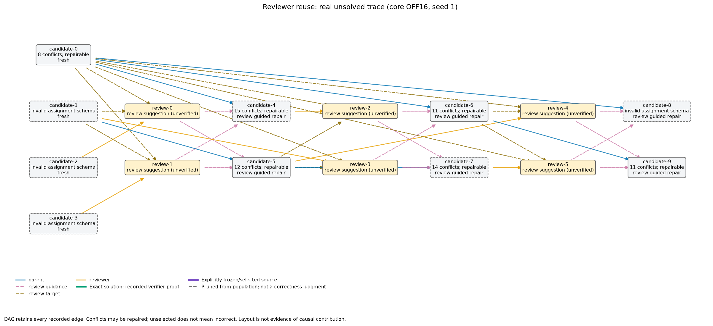

# Reviewer reuse: one real unsuccessful trace

This is the **first review_elites4 case** in the completed core OFF16 evaluation seed-1 case order. It was chosen by that order, not by its outcome. Task `eva-csp-17018a1d715fc166` has 24 vertices, 4 colors and 43 edges. The cohort and this trace were independently audited; no complete coloring was found.

Four initial assignment candidates are followed by three rounds of two reviews and two repair proposals: ten assignment calls plus six reviewer calls. Yellow nodes are unverified model critiques. Solid blue arrows retain parent assignments; orange arrows identify the earlier candidate reused as a reviewer; dashed gold arrows identify reviewed targets; dashed pink arrows show critique guidance. Dashed node borders mean a proposal left the retained population, not that every descendant is impossible. All recorded edges are retained.

The initial valid candidate has eight conflicts and remains better than the later valid repair proposals in this example. This illustrates a failed trajectory, not a causal estimate that reviewing makes a method worse. Use full cohort tables for method comparisons. No green solution node is invented.

[Vector figure](review-tree.svg) · [lineage data](lineage.json) · [original trace bytes](trace.jsonl) · [public graph](task.json) · [provenance](manifest.json)
